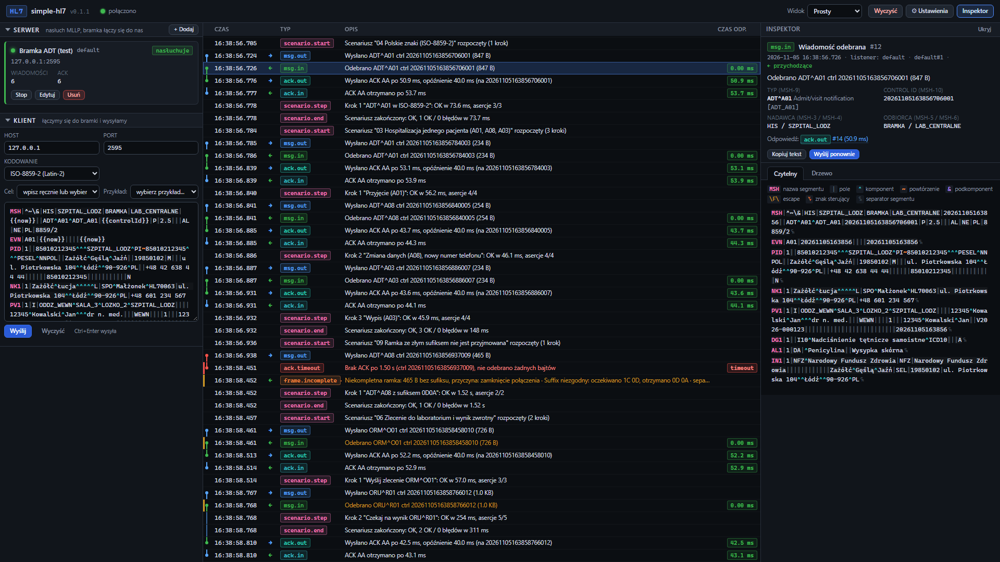
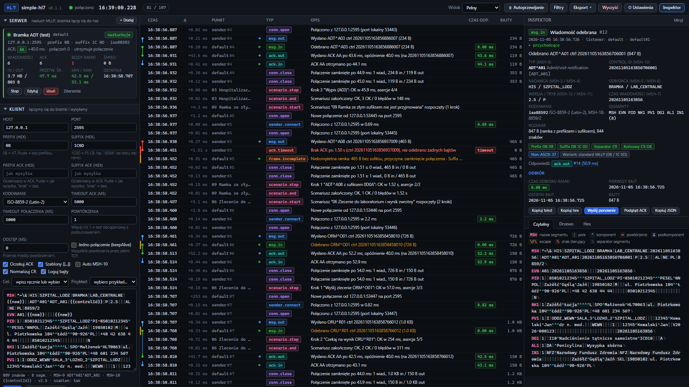
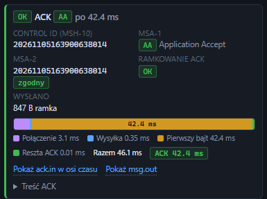
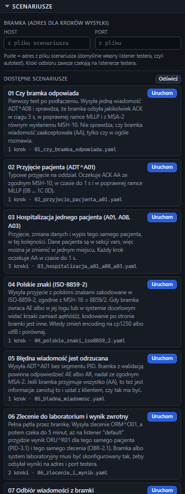
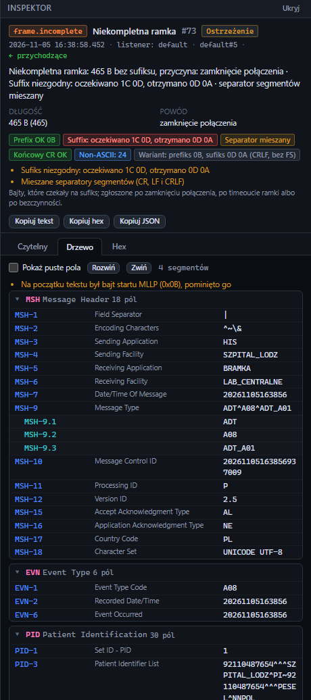
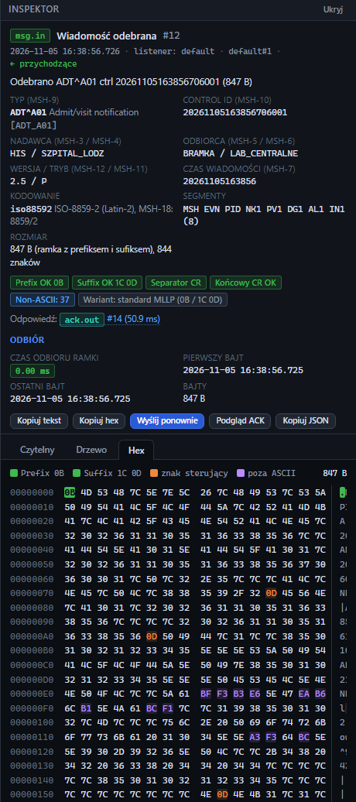
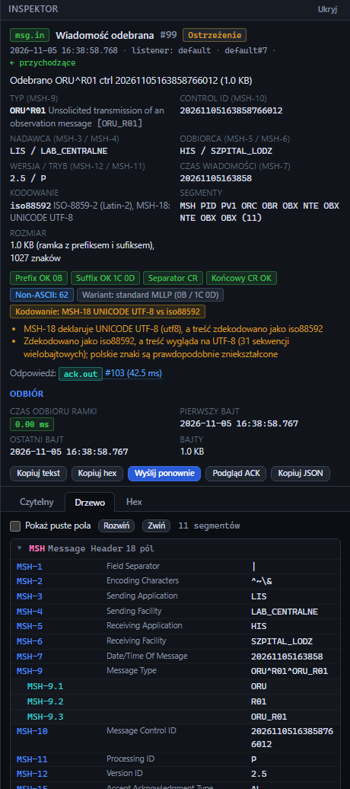

# simple-hl7

Tester bramek HL7 v2 po MLLP: jeden plik wykonywalny, bez instalacji, bez Dockera. Interfejs działa
w przeglądarce, a połączenia TCP otwiera sam program, więc można go położyć na serwerze u klienta
i obsługiwać z własnego laptopa. Każde zdarzenie na łączu (połączenie, bajty, ramka, wiadomość, ACK)
ma znacznik czasu z dokładnością do milisekundy, a każda ramka jest sprawdzana bajt po bajcie:
prefiks, sufiks, separatory segmentów i kodowanie.



Na zrzucie widok **Prosty**, w którym program startuje w nowej przeglądarce. Ramkę, czasy, filtry
i scenariusze pokazują widoki **Standardowy** i **Pełny**, patrz [Widok interfejsu](#widok-interfejsu).

Szczegółowa instrukcja obsługi, z opisem każdego kafelka, formularza i okna: [docs/instrukcja](docs/instrukcja/README.md).

Jedna instancja działa jednocześnie jako serwer i jako klient MLLP:

| Tryb | Panel | Kto otwiera połączenie TCP | Do czego |
|---|---|---|---|
| **Serwer** | Serwer | bramka łączy się do testera (domyślnie port 2575) | test wysyłki z bramki: tester odbiera, sprawdza ramkę, odsyła ACK |
| **Klient** | Klient | tester łączy się do bramki (host i port bramki) | test odbioru przez bramkę: tester wysyła i mierzy czas ACK |

Oba tryby mogą działać naraz. Tester wysyła zlecenie do bramki jako klient, a bramka odsyła wynik na
listener testera. Tak testuje się pełną pętlę z pomiarem czasu w obu kierunkach.

## Uruchomienie

Gotowe pliki są na stronie projektu: **https://mysttic.github.io/Mysttic/simple-hl7/**. Każde wydanie
to dwa pliki wykonywalne i plik z sumami kontrolnymi SHA-256.

| System | Plik | Jak |
|---|---|---|
| Windows x64 | `simple-hl7-<wersja>-windows-amd64.exe` | dwuklik lub z konsoli |
| Linux x64 | `simple-hl7-<wersja>-linux-amd64` | `chmod +x plik && ./plik` |

Plik zawiera wszystko: środowisko Node, aplikację i interfejs. Na serwerze nie trzeba nic instalować.
Wersja dla Linuksa działa na dystrybucjach x64 z glibc 2.28 lub nowszym (RHEL, Rocky i Alma 8+,
Ubuntu 20.04+, Debian 10+).

Przy pierwszym starcie program tworzy obok siebie katalogi i pliki:

```
simple-hl7-0.1.0-windows-amd64.exe
config/app.json        konfiguracja (listenery, domyślne ustawienia klienta, progi czasów)
logs/events.ndjson     pełny dziennik zdarzeń, jedno zdarzenie na linię
scenarios/*.yaml       gotowe scenariusze testów, można je edytować i dodawać własne
examples/*.hl7         przykładowe wiadomości do panelu Klient i scenariuszy
```

Istniejące pliki nigdy nie są nadpisywane. Nowa wersja programu wgrana do tego samego katalogu
korzysta ze starej konfiguracji i scenariuszy.

Po starcie konsola pokazuje adresy interfejsu. Przy uruchomieniu z konsoli lub dwuklikiem program
otwiera przeglądarkę pod `http://localhost:7575`. Z innego komputera wejdź na
`http://<adres-serwera>:7575`. Domyślny listener `default` nasłuchuje na `0.0.0.0:2575`.

Flagi:

```
--listen <host:port>   adres interfejsu (domyślnie z config/app.json: 0.0.0.0:7575);
                       sam port (--listen 9090) zostawia host z konfiguracji
--config <plik>        inny plik konfiguracji (domyślnie config/app.json obok programu)
--no-browser           nie otwieraj przeglądarki
--version              wypisz wersję i zakończ
--help                 pomoc
```

Ctrl+C w oknie konsoli zatrzymuje program. Stałą instalację na serwerze (autostart na Windows,
usługa systemd na Linuksie, firewall) opisuje [docs/DEPLOY.md](docs/DEPLOY.md).

**Windows SmartScreen.** Plik nie jest podpisany cyfrowo, więc przy pierwszym uruchomieniu Windows
może pokazać ostrzeżenie. Wybierz „Więcej informacji”, a potem „Uruchom mimo to”. Sumy kontrolne
SHA-256 są w pliku `simple-hl7-<wersja>-checksums.txt` z tego samego wydania.

## Widok interfejsu

Lista **Widok** w górnym pasku decyduje, ile szczegółów pokazuje ekran. Ukryte elementy nadal działają,
zmienia się tylko to, co widać.

| Widok | Co pokazuje |
|---|---|
| **Prosty** | serwer, klient (host, port, kodowanie, edytor), oś czasu z kolumnami Czas, Typ, Opis i Czas odp., inspektor z danymi MSH, walidacją ACK i zakładkami Czytelny i Drzewo |
| **Standardowy** | do tego ramkę (prefiks i sufiks) w kliencie, na kafelkach i w inspektorze, statystyki serwera, timeouty, filtry, eksport, scenariusze, kolumnę Punkt i zakładkę Hex |
| **Pełny** | wszystko, w tym zegar, licznik, ramkę ACK, serię wysyłek, przełączniki klienta, pasek czasów, kolumny Δ i Bajty, zdarzenia połączeń, Kopiuj JSON i Podgląd ACK |
| **Własny** | dowolny zestaw z 29 elementów, zaznaczony w oknie **⚙ Ustawienia** |

Nowa przeglądarka zaczyna w widoku Prosty, a przeglądarka, w której program był już używany, w widoku
Pełny. Wybór zapisuje się w przeglądarce. Gdy ukryte pole klienta ma wartość inną niż domyślna, panel
**Klient** pokazuje to nad przyciskiem **Wyślij** z linkiem **Przywróć domyślne**. Opisy w dalszej części
README dotyczą widoku Pełny. Szczegóły: [instrukcja, Widok interfejsu](docs/instrukcja/08-widok.md).



## Pierwszy test krok po kroku

Przykład: u klienta jest bramka integracyjna, do której HIS wysyła ADT, a która przekazuje wyniki
z laboratorium dalej. Sprawdzamy oba kierunki.

1. **Wgraj program na serwer**, z którego bramka jest osiągalna, np. do `C:\simple-hl7\`, i uruchom go.
2. **Otwórz porty**, jeśli interfejs lub bramka łączą się z innej maszyny. Na Windows w konsoli administratora:

   ```bat
   netsh advfirewall firewall add rule name="simple-hl7 UI" dir=in action=allow protocol=TCP localport=7575
   netsh advfirewall firewall add rule name="HL7 tester MLLP" dir=in action=allow protocol=TCP localport=2575
   ```

3. **Sprawdź, czy bramka w ogóle odpowiada.** Ustaw **Widok** w górnym pasku na **Standardowy**
   (panel **Scenariusze**, filtry, eksport i znaczki ramki). W panelu **Scenariusze** wpisz host i port
   bramki, a potem uruchom `01 Czy bramka odpowiada`. Zielony wynik oznacza, że bramka przyjmuje
   połączenie, rozumie ramkę MLLP i odsyła ACK z poprawnym MSA-2.
4. **Wyślij konkretną wiadomość.** W panelu **Klient** podaj host i port bramki, wybierz przykład
   (np. `adt_a01.hl7`) i naciśnij **Wyślij** albo Ctrl+Enter. Wynik pokazuje MSA-1 i zgodność MSA-2
   z wysłanym MSH-10, a w widoku Pełny także ramkę ACK i rozkład czasu: połączenie, wysyłka, pierwszy
   bajt odpowiedzi, kompletny ACK.

   

5. **Odbierz wiadomość z bramki.** Skonfiguruj w bramce kanał wyjściowy MLLP na adres serwera testera
   i port `2575`, uruchom scenariusz `07 Odbiór wiadomości z bramki` i wywołaj wysyłkę po stronie bramki.
   Na osi czasu pojawią się `msg.in` i `ack.out`, a inspektor pokaże znaczki ramki.
6. **Przejdź resztę scenariuszy** od `02` do `09`: przyjęcie, hospitalizacja, polskie znaki,
   odrzucanie błędnych wiadomości, pętla zlecenie i wynik, czas odpowiedzi przy serii, zły sufiks.
7. **Zbierz dowody.** **Eksport** w górnym pasku zapisuje CSV z czasami do raportu.
   Pełna historia z treścią wiadomości jest w `logs/events.ndjson`.

## Serwer (listenery)

Panel **Serwer** pokazuje kartę każdego nasłuchu: stan, port, ramkę, kodowanie, tryb ACK, liczniki
(wiadomości, ACK, błędy ramki) i czas przetwarzania (średni, minimalny, maksymalny). Można dodać
kolejny listener na innym porcie, np. osobny dla wyników z laboratorium albo z innym kodowaniem.

| Pole | Domyślnie | Znaczenie |
|---|---|---|
| `host`, `port` | `0.0.0.0`, `2575` | adres nasłuchu; `127.0.0.1` przyjmuje tylko połączenia z tej maszyny |
| `prefixHex`, `suffixHex` | `0B`, `1C0D` | oczekiwana ramka MLLP |
| `encoding` | `utf8` | kodowanie wiadomości i ACK: `utf8`, `cp1250`, `iso88592`, `latin1`, `windows1252`, `ascii` |
| `ack.mode` | `AA` | `AA`, `AE`, `AR`, `none` (bez ACK) albo `custom` (własny szablon) |
| `ack.delayMs` | `0` | sztuczne opóźnienie ACK, do testu timeoutów i ponowień po stronie bramki |
| `ack.textMessage`, `ack.errorCode` | puste | MSA-3 oraz kod błędu w segmencie ERR dla `AE` i `AR` |
| `ack.prefixHex`, `ack.suffixHex` | jak wejście | ramka ACK; celowo zła ramka sprawdza, jak bramka reaguje na błędny ACK |
| `keepConnection` | `true` | `false` zamyka połączenie po każdym ACK |
| `frameTimeoutMs` | `3000` | po tylu ms ciszy ramka bez sufiksu jest zgłaszana jako `frame.incomplete`, połączenie zostaje otwarte |
| `idleTimeoutMs` | `0` | po tylu ms ciszy połączenie jest zamykane; `0` wyłącza |
| `maxMessageBytes` | `10485760` | limit rozmiaru ramki |
| `autoStart` | `true` | start razem z programem |
| `logBytes` | `true` | zdarzenia `bytes.in` i `bytes.out` z każdym fragmentem TCP |

Hex można wpisywać jako `0B`, `0x0B`, `0B 1C 0D` albo `0B,1C,0D`. Pusty ciąg oznacza brak prefiksu lub sufiksu.

Tryb ACK `custom` wysyła szablon dokładnie tak, jak go zapisano, więc nadaje się też do celowo
błędnych odpowiedzi. Przykład z danymi z wiadomości wejściowej:

```
MSH|^~\&|{{field:MSH-5}}|{{field:MSH-6}}|{{field:MSH-3}}|{{field:MSH-4}}|{{now}}||ACK|{{controlId}}|P|2.5
MSA|AA|{{field:MSH-10}}
```

**Polskie znaki.** Listener dekoduje bajty kodowaniem z pola `encoding` i porównuje wynik z MSH-18.
Niezgodność, np. MSH-18 `8859/2` przy bajtach UTF-8, jest pokazywana jako ostrzeżenie w inspektorze.

## Klient (wysyłanie)

Panel **Klient** wysyła wiadomość do bramki i czeka na ACK. Pola: host i port bramki, ramka
wysyłana i oczekiwana ramka ACK, kodowanie, timeouty, liczba powtórzeń z odstępem, jedno połączenie
dla wszystkich powtórzeń (`keepAlive`), automatyczny MSH-10. Treść jest kolorowana na bieżąco.
Formularz zapamiętuje się w przeglądarce.

Wynik pokazuje MSA-1, zgodność MSA-2 z wysłanym MSH-10, poprawność ramki ACK i pasek czasów. Przy
powtórzeniach dochodzi podsumowanie: liczba, udane, nieudane oraz czas ACK minimalny, średni,
maksymalny i p95. Celowo zła ramka wysyłana (np. sufiks `0D0A`) sprawdza odporność bramki.

Placeholdery działają w treści wiadomości, w plikach `examples/*.hl7`, w szablonie ACK i w scenariuszach:

| Placeholder | Wynik |
|---|---|
| `{{controlId}}` | nowy identyfikator, 20 znaków; ta sama wartość w całej wiadomości |
| `{{now}}` | bieżący czas `YYYYMMDDHHmmss` |
| `{{now:FORMAT}}` | czas w formacie z tokenami `YYYY MM DD HH mm ss SSS`, np. `{{now:YYYYMMDD}}` |
| `{{seq}}` | licznik od 1, rośnie z każdą wiadomością |
| `{{field:PID-3.1}}` | pole wiadomości wejściowej (szablon ACK) |
| `{{vars.nazwa}}` | zmienna ze scenariusza |

## Scenariusze

Scenariusz to plik YAML z krokami: wyślij i sprawdź ACK, poczekaj na wiadomość od bramki i sprawdź
jej pola, odczekaj. Panel **Scenariusze** ma pola **Host** i **Port** bramki, które nadpisują adres
z pliku, więc tych samych plików używa się u każdego klienta bez edycji. Puste pola oznaczają adres
z pliku, czyli domyślnie własny listener testera. Dzięki temu każdy scenariusz można uruchomić
od razu, bez bramki, i zobaczyć, jak działa.
Trzy scenariusze zachowują się bez bramki inaczej niż przy niej: `05` kończy się błędem, bo własny
listener odpowiada AA na wszystko; `06` czeka na wynik, który trzeba odesłać samemu (w panelu
**Klient** wybierz przykład `oru_r01` i wyślij go w ciągu 5 minut); `07` czeka na dowolną wiadomość,
np. wysłaną z panelu **Klient**. Uruchomiony scenariusz przerywa przycisk **Zatrzymaj** na jego kafelku.

| Scenariusz | Co sprawdza |
|---|---|
| `01_czy_bramka_odpowiada` | jakikolwiek ACK w 3 s, poprawna ramka, MSA-2 równe MSH-10 |
| `02_przyjecie_pacjenta_a01` | ADT^A01 przyjęty (AA) w czasie do 1 s |
| `03_hospitalizacja_a01_a08_a03` | przyjęcie, zmiana danych i wypis jednego pacjenta, dane w `vars` |
| `04_polskie_znaki_iso8859_2` | wiadomość z polskimi znakami w ISO-8859-2 zgodnie z MSH-18 |
| `05_bledna_wiadomosc` | ADT^A01 bez PID ma dostać AE albo AR |
| `06_zlecenie_i_wynik` | ORM^O01 do bramki, potem wynik ORU^R01 na listener testera dla tego samego pacjenta i zlecenia |
| `07_odbior_z_bramki` | dowolna wiadomość od bramki: prefiks, sufiks, separatory CR, CR przed sufiksem |
| `08_czas_odpowiedzi_20x` | 20 wiadomości na jednym połączeniu, każdy ACK do 500 ms |
| `09_zly_sufiks` | ramka z sufiksem `0D0A` nie powinna dostać ACK |



Składnia plików, wszystkie asercje i przykłady własnych scenariuszy: [docs/SCENARIOS.md](docs/SCENARIOS.md).

## Oś czasu i czasy odpowiedzi

Każde zdarzenie ma czas `HH:mm:ss.SSS` (pełny czas ISO po najechaniu), odstęp od poprzedniego wiersza,
punkt (listener, klient lub scenariusz z numerem połączenia TCP), kierunek, typ, opis i czas odpowiedzi
kolorowany progami z ustawień. Najechanie na wiersz podświetla zdarzenia z tego samego połączenia
i z tym samym control id, a pionowe kreski po lewej łączą wiadomość z jej ACK. Pasek **Filtry**
zawęża widok do typów, punktu, tekstu albo poziomu.

Wszystkie czasy liczone są z zegara monotonicznego procesu, więc korekta zegara systemowego w trakcie
testu ich nie psuje:

| Czas | Od | Do | Co mówi |
|---|---|---|---|
| `ackMs` | wypchnięcie ramki | kompletny ACK | **czas odpowiedzi bramki**, do porównania z SLA |
| `connectMs` | start wysyłki | nawiązane połączenie TCP | dostępność portu, firewall, DNS |
| `sendMs` | nawiązane połączenie | wypchnięta cała ramka | zwykle ułamek milisekundy |
| `firstByteMs` | wypchnięcie ramki | pierwszy bajt odpowiedzi | kiedy bramka zaczęła odpowiadać |
| `totalMs` | start wysyłki | koniec (ACK, timeout, błąd) | łączny czas jednej wysyłki |
| `receiveMs` | pierwszy bajt ramki od bramki | skompletowany sufiks | jak długo bramka wypychała wiadomość |
| `processingMs` | skompletowana ramka od bramki | wysłany ACK | czas odpowiedzi testera widziany przez bramkę (z `ack.delayMs`) |

Najważniejsze typy zdarzeń:

| Typ | Znaczenie |
|---|---|
| `conn.open`, `conn.close`, `conn.error` | połączenie TCP: kto, skąd, jak długo, ile bajtów |
| `msg.in`, `ack.out` | wiadomość odebrana przez serwer i jego ACK |
| `msg.out`, `ack.in` | wiadomość wysłana przez klienta i ACK bramki z walidacją |
| `ack.timeout` | brak ACK w czasie; pokazuje bajty, które zdążyły przyjść |
| `frame.incomplete` | bajty bez sufiksu, z analizą oczekiwanej i faktycznej ramki |
| `bytes.in`, `bytes.out` | pojedyncze fragmenty TCP; ukryte domyślnie, włącza się je w **Ustawieniach** |
| `scenario.start`, `scenario.step`, `scenario.end` | przebieg scenariusza |

## Weryfikacja ramki i typowe problemy

Każda ramka, także ACK, przechodzi analizę: oczekiwany i faktyczny prefiks i sufiks, separator
segmentów, CR przed sufiksem, bajty spoza ASCII, znaki sterujące w treści i podpowiedź wariantu
ramki. Inspektor pokazuje to jako znaczki: zielony `Prefix OK 0B` albo czerwony
`Suffix: oczekiwano 1C 0D, otrzymano 0D 0A`.



| Objaw | Co widać | Co zrobić |
|---|---|---|
| zły sufiks od bramki (`0D0A`, samo `1C`) | brak `msg.in` i ACK, po 3 s `frame.incomplete` z wariantem, np. `suffix 0D 0A (CRLF, no FS)` | poprawić ramkę w bramce albo ustawić `suffixHex` listenera tak, jak wysyła bramka |
| zły lub brakujący prefiks | `msg.in` z czerwonym znaczkiem prefiksu; wiadomość jest mimo to odebrana i potwierdzona | poprawić ramkę w bramce |
| bramka nie odpowiada na naszą wiadomość | `ack.timeout`; jeśli coś przyszło, widać to w hex i analizie ramki | sprawdzić sufiks wysyłany i oczekiwaną ramkę ACK |
| separatory LF zamiast CR | znaczek `Separator LF` i ostrzeżenie | wiele bramek odrzuca takie wiadomości; klient testera zawsze wysyła CR |
| brak CR przed sufiksem | znaczek końcowego CR na czerwono | specyfikacja MLLP wymaga `<CR><FS><CR>` na końcu |
| krzaki zamiast polskich znaków | ostrzeżenie o kodowaniu, `�` w treści | dopasować `encoding`; w zakładce **Hex** `C5 BC` to `ż` w UTF-8, `BF` to `ż` w cp1250 i ISO-8859-2 |

## Inspektor

Kliknięcie wiersza otwiera inspektor: typ wiadomości, control id, nadawca i odbiorca, wersja,
kodowanie, znaczki ramki i ostrzeżenia, a dla wiadomości także powiązany ACK z czasem. Zakładki:

| Zakładka | Zawartość |
|---|---|
| **Czytelny** | segmenty w osobnych liniach, kolorowane separatory, pola i składowe; znaki sterujące jako symbole; po najechaniu numer i nazwa pola, np. `PID-3 Patient Identifier List` |
| **Drzewo** | segmenty, pola z numerami i nazwami ze słownika, składowe i powtórzenia |
| **Hex** | zrzut bajtów ramki z zaznaczonym prefiksem i sufiksem, znakami sterującymi i bajtami spoza ASCII |

| Hex | Drzewo |
|---|---|
|  |  |

Przyciski: kopiuj tekst, kopiuj hex, kopiuj zdarzenie jako JSON, **Wyślij ponownie** (wkłada treść do
panelu Klient) i **Podgląd ACK** (jaki ACK powstałby dla wybranego kodu, bez wysyłania).

## Dane, eksport i konfiguracja

- **Eksport** w górnym pasku zapisuje zdarzenia z bieżącymi filtrami jako CSV (`id, ts, source,
  endpointId, connId, type, direction, level, summary, latencyMs`; średnik, przecinek dziesiętny i UTF-8
  z BOM, więc polski Excel otwiera go dwuklikiem w kolumnach) albo NDJSON z pełną treścią.
- W pamięci jest ostatnie 5000 zdarzeń (`events.maxEvents`). Wszystkie trafiają też do
  `logs/events.ndjson` (`events.ndjsonPath`, `null` wyłącza). Plik rośnie bez limitu: usuwaj go
  po zakończeniu testów.
- `config/app.json` zmienia się z poziomu interfejsu. Ręczne zmiany w pliku wymagają restartu programu.
- Zmienne środowiskowe `HL7T_WEB_PORT` (lub `PORT`), `HL7T_WEB_HOST` i `HL7T_CONFIG` działają jak flagi.
  Flagi mają pierwszeństwo przed zmiennymi, a zmienne przed plikiem. Ani flagi, ani zmienne nie są
  zapisywane do pliku.
- **Ustawienia** w interfejsie: progi kolorowania czasów, pokazywanie zdarzeń `bytes.*`, strefa czasu.

## Rozwiązywanie problemów

**`EADDRINUSE` przy listenerze.** Port zajmuje inny proces, często poprzednia kopia testera albo sama
bramka. Listener dostaje stan błędu, reszta programu działa. Znajdź proces: `netstat -ano | findstr :2575`
(Windows) albo `ss -ltnp | grep 2575` (Linux), potem zmień port w karcie listenera.

**`UI port 7575 is already in use`.** Uruchom z innym portem: `--listen 0.0.0.0:8090`.

**Bramka nie łączy się z listenerem.** Listener musi mieć stan `nasłuchuje` i host `0.0.0.0`, a firewall
serwera musi przepuszczać port. Test z maszyny bramki: `Test-NetConnection <serwer> -Port 2575`
(Windows) albo `nc -vz <serwer> 2575` (Linux). Udane połączenie daje na osi czasu `conn.open`.

**Klient: błąd w fazie łączenia.** `ECONNREFUSED`: nikt nie nasłuchuje na tym porcie. `ETIMEDOUT`:
firewall albo zły adres. `ENOTFOUND`: nazwa nie istnieje w DNS.

**`ack.timeout`, chociaż bramka twierdzi, że odpowiedziała.** Jeśli w zdarzeniu są bajty, ACK ma inną
ramkę niż oczekiwana: ustaw prefiks i sufiks ACK w panelu Klient. Jeśli nic nie przyszło, bramka
nie rozpoznała końca naszej ramki albo odpowiada na innym połączeniu.

**Interfejs się nie odświeża.** Czerwony pasek „Brak połączenia z serwerem” oznacza zerwane połączenie
WebSocket. Program łączy się ponownie sam i dociąga zaległe zdarzenia.

## Bezpieczeństwo

- Interfejs nie ma logowania. Każdy, kto go otworzy, może wysyłać HL7 na dowolny adres osiągalny
  z serwera i zmieniać listenery. Nie wystawiaj go do internetu.
- Gdy interfejs nie jest potrzebny z sieci, uruchom z `--listen 127.0.0.1:7575` i korzystaj z niego
  na serwerze albo przez tunel SSH. W przeciwnym razie ogranicz port 7575 na firewallu do adresów
  zespołu wdrożeniowego.
- `logs/events.ndjson` i eksporty zawierają pełną treść wiadomości, czyli dane pacjentów. Testuj na
  danych testowych, gdy to możliwe. Po testach usuń logi z serwera klienta i nie przekazuj ich poza
  uzgodniony krąg osób.
- Zatrzymaj program po zakończeniu testów, żeby listener nie przyjmował ruchu produkcyjnego.

## Budowanie

Potrzebny Node 22 i npm. Skrypt instaluje zależności, uruchamia testy i buduje plik dla systemu,
na którym działa:

```
build.cmd          Windows: dist\simple-hl7-<wersja>-windows-amd64.exe
sh build.sh        Linux:   dist/simple-hl7-<wersja>-linux-amd64
```

Wynik trafia do `dist/` razem z plikiem sum kontrolnych `simple-hl7-<wersja>-checksums.txt`. Plik ma około 85 MB, bo zawiera środowisko Node.
Pod spodem działa Node SEA (single executable application): esbuild składa kod w jeden plik,
interfejs, scenariusze i przykłady są dołączane jako zasoby, a całość trafia do kopii programu `node`.
Numer wersji pochodzi z `VERSION.md`. Plik dla Linuksa buduje się na Linuksie; wydania budują się same, patrz [Wydania](#wydania).

Bez budowania, prosto ze źródeł (Node 22):

```
npm ci
npm start
```

Tak uruchomiony program trzyma konfigurację i logi w katalogu projektu i czyta interfejs z `public/`.

## Rozwój i testy

```
npm test                       # testy jednostkowe, transport MLLP, scenariusze, API i WebSocket
npm run dev                    # start z automatycznym restartem po zmianie pliku
node scripts/screenshots.mjs   # odświeża zrzuty w docs/img (potrzebny Edge albo Chrome)
node scripts/manual-shots.mjs  # zrzuty elementów do instrukcji w docs/instrukcja/img
```

Testy używają losowych wolnych portów, więc nie kolidują z działającą kopią programu.
Budowa modułów, przepływ zdarzeń, REST API i WebSocket: [docs/ARCHITEKTURA.md](docs/ARCHITEKTURA.md).

Gałęzie: `develop` (praca) i `master` (wydania). CI (`.github/workflows/ci.yml`) nie startuje na
`develop`; uruchamia się na pull request `develop` → `master` albo ręcznie (`workflow_dispatch`).
Sprawdza składnię i testy, buduje plik wykonywalny na Windows i na Linuksie i uruchamia każdy z nich
testem dymnym (`scripts/smoke-exe.mjs`: start w pustym katalogu, interfejs, API, scenariusze, jedna
wiadomość MLLP z ACK).

## Wydania

- `VERSION.md` trzyma numer wersji (jedna linia, `major.minor.patch`). Program wkompilowuje go przy
  budowaniu, a ze źródeł czyta go przy starcie, więc plik wykonywalny, `--version` i tag zawsze się
  zgadzają. `package.json` ma stałą wersję `0.0.0` i nie jest publikowany.
- `CHANGELOG.md` opisuje zmiany w każdej wersji (format Keep a Changelog). Wydanie wymaga sekcji
  `## [x.y.z]` dla numeru z `VERSION.md`; jej treść staje się opisem release.
- Workflow `Release` (`.github/workflows/release.yml`) startuje po push do `master`, który zmienia
  `VERSION.md`, czyli po merge PR z `develop` z podbitym numerem. Publikuje tylko wtedy, gdy
  `VERSION.md` jest wyższy od najnowszego tagu `v*`. Wtedy: testy, build na Windows i Linuksie
  z testem dymnym każdego pliku, plik sum kontrolnych, tag `v<wersja>` i release w tym
  repozytorium, a potem job `site` kopiuje te same trzy pliki do Mysttic/Mysttic pod tagiem
  `simple-hl7-v<wersja>` i usuwa tam starsze wydania projektu. Strona
  https://mysttic.github.io/Mysttic/simple-hl7/ pokazuje je od razu, bez commita na hubie.
- Bez podniesienia `VERSION.md` merge nie publikuje nic. Obniżenie numeru albo brak sekcji
  w `CHANGELOG.md` zatrzymuje workflow z błędem. Wydanie, które nie wystartowało albo padło przed
  utworzeniem tagu, uruchamia się ręcznie: „Run workflow” na `master`. Wydanie, które padło po
  utworzeniu tagu (np. w jobie `site`), ponawia się przez „Re-run failed jobs”.

Procedura wydania:

1. Na `develop`: podnieść `VERSION.md`, dopisać sekcję w `CHANGELOG.md` (to, co było w
   `[Unreleased]`, pod nowym numerem i datą).
2. PR `develop` → `master`, poczekać na zielone CI i podgląd „Release preview”.
3. Merge. Release i kopia plików wydania na hub dzieją się same.
4. Gdy wydanie zmienia stronę projektu (opis, zrzuty), skopiować ją ręcznie na hub, patrz
   [site/README.md](site/README.md).

Wymagany sekret: `HUB_TOKEN` w ustawieniach repozytorium (Settings, Secrets and variables, Actions):
fine-grained token dla właściciela `Mysttic`, dostęp tylko do `Mysttic/Mysttic`, uprawnienie
Contents: Read and write. Bez niego release w tym repozytorium powstanie, a job `site` zakończy się
czytelnym błędem. Token ma datę ważności; po jej upływie job `site` zatrzyma się tym samym błędem.

Strona projektu na hubie leży gotowa w `site/simple-hl7/`; jak ją podpiąć i odświeżać, opisuje
[site/README.md](site/README.md).
