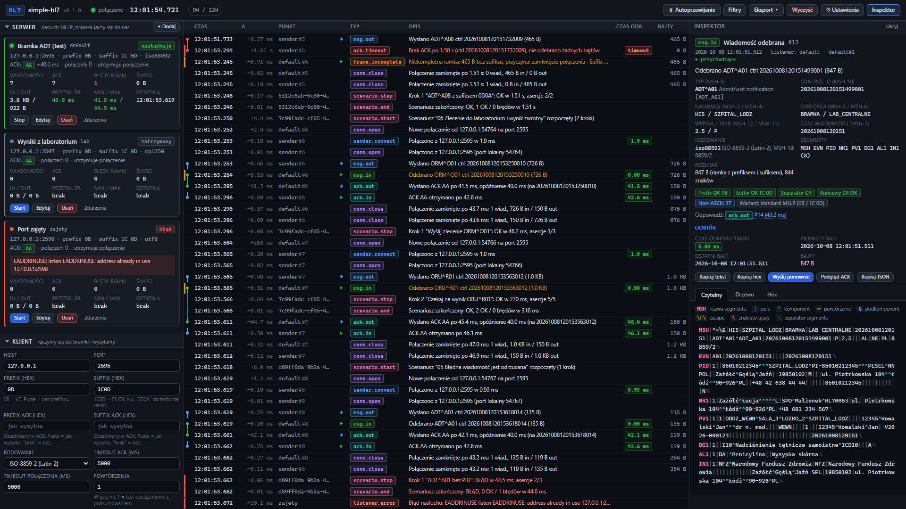

# Ekran główny

[Spis treści](README.md) · Następna: [Górny pasek](02-gorny-pasek.md) <!-- nav -->

Po otwarciu adresu programu w przeglądarce (domyślnie `http://localhost:8080`) widać jeden ekran
podzielony na cztery obszary. Wszystko, co dzieje się w testerze, widać od razu, bez odświeżania strony.

## Obszary ekranu

| Obszar | Gdzie | Do czego służy |
|---|---|---|
| [Górny pasek](02-gorny-pasek.md) | na górze | stan połączenia z programem, zegar serwera, licznik zdarzeń, przyciski ogólne |
| Panele sterowania | lewa kolumna | trzy sekcje: **Serwer** (listenery), **Klient** (wysyłanie do bramki), **Scenariusze** |
| [Oś czasu](40-os-czasu.md) | środek | wszystkie zdarzenia na żywo, z czasem co do milisekundy |
| Inspektor | prawa kolumna | szczegóły zaznaczonego zdarzenia: treść wiadomości, ramka, czasy |

Każdą sekcję lewej kolumny zwija się i rozwija kliknięciem jej nagłówka (trójkąt przy nazwie). Stan
sekcji przeglądarka pamięta po odświeżeniu strony.

Inspektor zmienia szerokość po przeciągnięciu jego lewej krawędzi. Dwuklik na krawędzi przywraca
szerokość domyślną. Przycisk **Inspektor** w górnym pasku albo klawisz `i` chowa i pokazuje panel.
Na ekranach węższych niż 1700 pikseli inspektor przechodzi pod oś czasu, a jego wysokość zmienia się
przeciągnięciem górnej krawędzi.

## Jak to działa w skrócie

1. Program na serwerze otwiera porty listenerów i czeka na bramkę. Każde połączenie, każdy fragment
   danych, każda wiadomość i każdy ACK stają się zdarzeniami.
2. Przeglądarka dostaje zdarzenia na bieżąco i dopisuje je na dole osi czasu.
3. Kliknięcie wiersza osi czasu pokazuje zdarzenie w inspektorze.
4. Panele po lewej zmieniają konfigurację (listenery), wysyłają wiadomości (klient) i uruchamiają
   scenariusze. Wynik każdej z tych akcji też trafia na oś czasu.

Program pracuje niezależnie od przeglądarki. Zamknięcie karty nie zatrzymuje listenerów ani
scenariuszy, a po ponownym otwarciu oś czasu dociąga zdarzenia z serwera.

## Skróty klawiszowe

Skróty nie działają, gdy kursor stoi w polu tekstowym, z wyjątkiem `Ctrl+Enter` w edytorze wiadomości.

| Klawisz | Działanie |
|---|---|
| `↓` / `↑` | zaznacz następne / poprzednie zdarzenie na osi czasu |
| `PageDown` / `PageUp` | przeskocz o 20 zdarzeń w dół / w górę |
| `End` | wznów autoprzewijanie i przejdź do najnowszego zdarzenia |
| `Spacja` | wstrzymaj albo wznów autoprzewijanie (gdy aktywna jest oś czasu albo strona) |
| `Esc` | zamknij otwarte okno; bez okna: odznacz zdarzenie i wyczyść inspektor |
| `/` | otwórz pasek filtrów i ustaw kursor w polu wyszukiwania |
| `i` | pokaż albo ukryj inspektor |
| `Ctrl+Enter` | w edytorze wiadomości panelu Klient: wyślij |
| `Enter` | w polu formularza serwera: zapisz formularz |

## Gdzie zapisują się ustawienia

| Co | Gdzie | Widoczne dla |
|---|---|---|
| listenery, domyślne ustawienia klienta, progi czasów | plik `config/app.json` obok programu | wszystkich użytkowników tego programu |
| formularz klienta, adres bramki dla scenariuszy, rozwinięte sekcje, szerokość inspektora, pokazywanie zdarzeń bajtów, strefa czasu | pamięć tej przeglądarki | tylko tej przeglądarki na tym komputerze |
| zdarzenia | pamięć programu (ostatnie 5000) i plik `logs/events.ndjson` | wszystkich |

---

[Spis treści](README.md) · Następna: [Górny pasek](02-gorny-pasek.md) <!-- nav -->
