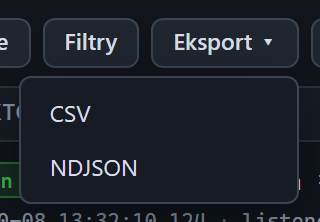

# Menu Eksport

[Spis treści](README.md) · Poprzednia: [Górny pasek](02-gorny-pasek.md) · Następna: [Okno Ustawienia](04-okno-ustawien.md) <!-- nav -->

Przycisk **Eksport ▾** w górnym pasku rozwija menu z dwoma formatami. Wybranie formatu od razu pobiera
plik do folderu pobierania przeglądarki. Menu zamyka się po wyborze albo po kliknięciu w innym miejscu.

## Formaty

| Pozycja | Zawartość pliku | Do czego |
|---|---|---|
| **CSV** | jeden wiersz na zdarzenie, średnik między kolumnami, przecinek dziesiętny, UTF-8 z BOM; kolumny: `id`, `ts` (czas ISO z milisekundami, UTC), `source`, `endpointId`, `connId`, `type`, `direction`, `level`, `summary`, `latencyMs` | otwarcie w arkuszu, tabela czasów odpowiedzi do raportu z testów |
| **NDJSON** | jedno pełne zdarzenie w formacie JSON na wiersz, razem z treścią wiadomości, bajtami w hex, analizą ramki i wszystkimi czasami | archiwum testu, analiza problemu, przekazanie do zespołu bramki |

Plik ma nazwę `simple-hl7-events-<data i godzina>.csv` albo `.ndjson`. CSV jest przygotowany pod Excela
z polskimi ustawieniami: otwiera się dwuklikiem od razu w kolumnach, z polskimi znakami i liczbami.

## Co trafia do pliku

- Eksport bierze zdarzenia z pamięci programu, nie z przeglądarki. Program trzyma ostatnie 5000 zdarzeń,
  więc plik może zawierać więcej wierszy niż oś czasu.
- Aktywne [filtry](41-pasek-filtrow.md) osi czasu działają też na eksport: typy, punkt, tekst i poziom.
  Powiadomienie po rozpoczęciu eksportu mówi wtedy „z aktywnymi filtrami”. Filtr tekstowy program
  sprawdza po swojej stronie, na angielskim opisie i treści zdarzenia, więc przy wyszukiwaniu po
  polskich słowach z opisu albo po adresie IP plik może mieć mniej wierszy niż oś czasu. Szukaj raczej
  po control id albo fragmencie treści wiadomości.
- Gdy w Ustawieniach zdarzenia bajtów są ukryte, eksport też je pomija.
- Kolumna `summary` w CSV zawiera opis zdarzenia w wersji z logów programu, po angielsku. Polski opis
  widać tylko na osi czasu.

## Wskazówki

- Do raportu czasów odpowiedzi bramki: włącz filtr typów **ACK odebrany** i wyeksportuj CSV.
  Kolumna `latencyMs` zawiera wtedy czas odpowiedzi bramki w milisekundach.
- Pełna historia, także sprzed wyczyszczenia osi czasu albo restartu programu, jest w pliku
  `logs/events.ndjson` obok programu, w tym samym formacie co eksport NDJSON.
- Eksporty zawierają dane pacjentów, jeśli testy szły na prawdziwych danych. Traktuj pliki tak jak
  dokumentację medyczną.

---

[Spis treści](README.md) · Poprzednia: [Górny pasek](02-gorny-pasek.md) · Następna: [Okno Ustawienia](04-okno-ustawien.md) <!-- nav -->
