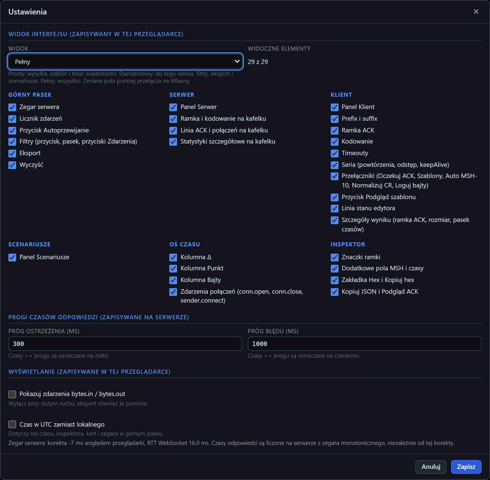

# Okno Ustawienia

[Spis treści](README.md) · Poprzednia: [Menu Eksport](03-menu-eksport.md) · Następna: [Czyszczenie zdarzeń](05-czyszczenie-zdarzen.md) <!-- nav -->

Okno otwiera przycisk **⚙ Ustawienia** w górnym pasku. Ma trzy części. Progi zapisują się na serwerze,
widok i wyświetlanie w przeglądarce.

## Widok interfejsu (zapisywany w tej przeglądarce)

Lista **Widok** wybiera, ile szczegółów pokazuje ekran: **Prosty**, **Standardowy**, **Pełny** albo
**Własny**. Pod nią jest licznik widocznych elementów i 29 elementów w sześciu grupach. Zaznaczony
element jest widoczny, a zmiana dowolnego pola przełącza listę na **Własny**. Ekran zmienia się od razu,
jeszcze przed zapisem. Co zawiera każdy widok, opisuje strona [Widok interfejsu](08-widok.md).

## Progi czasów odpowiedzi (zapisywane na serwerze)

Progi decydują o kolorze każdego czasu w programie: na osi czasu, w kafelkach serwera, w wynikach
wysyłki i w inspektorze. Zapisują się w konfiguracji programu, więc obowiązują dla wszystkich
przeglądarek.

| Pole | Domyślnie | Znaczenie |
|---|---|---|
| **Próg ostrzeżenia (ms)** | 300 | czasy równe lub większe od progu są żółte |
| **Próg błędu (ms)** | 1000 | czasy równe lub większe od progu są czerwone |

Czasy poniżej progu ostrzeżenia są zielone. Oba progi muszą być liczbami od 1 w górę, a próg błędu
musi być większy od progu ostrzeżenia, inaczej okno pokaże błąd przy polu i nie zapisze zmian.

Ustaw progi według umowy z klientem. Przy SLA „odpowiedź w ciągu 1 sekundy” sensowne są np. 500 ms
(ostrzeżenie) i 1000 ms (błąd).

## Wyświetlanie (zapisywane w tej przeglądarce)

| Pole | Domyślnie | Znaczenie |
|---|---|---|
| **Pokazuj zdarzenia bytes.in / bytes.out** | wyłączone | pokazuje na osi czasu każdy fragment danych TCP. Przydaje się, gdy bramka dzieli wiadomość na wiele pakietów albo wysyła dodatkowe bajty. Przy dużym ruchu zaśmieca oś czasu. Gdy jest wyłączone, eksport też pomija te zdarzenia |
| **Czas w UTC zamiast lokalnego** | wyłączone | pokazuje wszystkie czasy w UTC: na osi czasu, w inspektorze, na kartach i w zegarze górnego paska. Przydaje się przy porównaniu z logami bramki pisanymi w UTC |

Pod polami okno pokazuje bieżącą korektę zegara serwera względem przeglądarki i opóźnienie
połączenia (RTT). Korekta dotyczy tylko wyświetlania zegara. Czasy odpowiedzi program liczy na
serwerze z zegara monotonicznego, więc korekta ani zmiana zegara systemowego na nie nie wpływa.

## Przyciski

- **Zapisz** zapisuje zmiany i odświeża kolory na osi czasu, w kafelkach i w inspektorze.
- **Anuluj**, `×` albo `Esc` zamykają okno bez zmian. Widok wybrany w oknie wraca do poprzedniego.

---

[Spis treści](README.md) · Poprzednia: [Menu Eksport](03-menu-eksport.md) · Następna: [Czyszczenie zdarzeń](05-czyszczenie-zdarzen.md) <!-- nav -->
