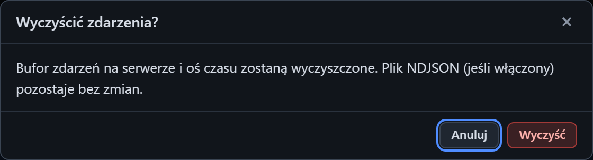

# Czyszczenie zdarzeń

[Spis treści](README.md) · Poprzednia: [Okno Ustawienia](04-okno-ustawien.md) · Następna: [Brak połączenia z serwerem](06-brak-polaczenia.md) <!-- nav -->

Przycisk **Wyczyść** w górnym pasku usuwa zdarzenia. Przed usunięciem program pyta o potwierdzenie.

## Przyciski okna

| Przycisk | Działanie |
|---|---|
| **Wyczyść** (czerwony) | usuwa zdarzenia z pamięci programu i czyści oś czasu oraz inspektor |
| **Anuluj**, `×`, `Esc` | zamyka okno bez zmian |

## Co zostaje usunięte, a co nie

| Usunięte | Bez zmian |
|---|---|
| zdarzenia w pamięci programu (to, co pokazuje oś czasu i co trafia do eksportu) | plik `logs/events.ndjson` z pełną historią |
| oś czasu we wszystkich otwartych przeglądarkach (każda dostaje powiadomienie „Zdarzenia zostały wyczyszczone”) | listenery, ich konfiguracja i otwarte połączenia |
| | liczniki na kafelkach serwerów |
| | lista ostatnich uruchomień scenariuszy |

## Kiedy czyścić

- Przed nową serią testów, żeby eksport CSV zawierał tylko tę serię.
- Przed pokazaniem wyników klientowi, żeby na osi czasu nie było wcześniejszych prób.

Czyszczenie dotyczy wszystkich osób, które w tym momencie mają otwarty interfejs tego programu.
Jeśli testuje kilka osób naraz, uzgodnij to z nimi.

---

[Spis treści](README.md) · Poprzednia: [Okno Ustawienia](04-okno-ustawien.md) · Następna: [Brak połączenia z serwerem](06-brak-polaczenia.md) <!-- nav -->
