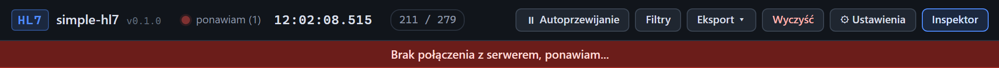

# Brak połączenia z serwerem

[Spis treści](README.md) · Poprzednia: [Czyszczenie zdarzeń](05-czyszczenie-zdarzen.md) · Następna: [Powiadomienia](07-powiadomienia.md) <!-- nav -->

> Na zrzucie pusty środek górnego paska został wycięty.

Czerwony pasek pojawia się pod górnym paskiem, gdy przeglądarka straciła połączenie na żywo
(WebSocket) z programem. Jednocześnie napis stanu w górnym pasku zmienia się na **ponawiam (N)**.

## Co robi przeglądarka

- Ponawia połączenie sama, z rosnącym odstępem między próbami, najwyżej co 10 sekund. N w górnym
  pasku to numer próby.
- Kliknięcie czerwonego paska wymusza próbę od razu.
- Po odzyskaniu połączenia pasek znika, a oś czasu dociąga zdarzenia z czasu przerwy. Powiadomienie
  mówi wtedy „Uzupełniono N zdarzeń z okresu bez połączenia”.
- Jeśli w tym czasie program był uruchomiony ponownie, oś czasu buduje się od nowa. Powiadomienie:
  „Serwer został uruchomiony ponownie, oś czasu przebudowana”.

Program na serwerze działa dalej niezależnie od przeglądarki. Listenery przyjmują wiadomości, odsyłają
ACK i zapisują zdarzenia także wtedy, gdy nikt nie ma otwartego interfejsu.

## Najczęstsze przyczyny

| Przyczyna | Co sprawdzić |
|---|---|
| program zatrzymany (Ctrl+C, zamknięte okno konsoli, restart serwera) | czy proces działa; uruchom go ponownie |
| przerwa w sieci między komputerem a serwerem | VPN, Wi-Fi, firewall |
| reverse proxy bez obsługi WebSocket | konfiguracja proxy, patrz [docs/DEPLOY.md](../DEPLOY.md), sekcja „Za reverse proxy” |

Jeśli zaraz po otwarciu strony pojawi się powiadomienie „Dane pobrane przez REST (WebSocket jeszcze
nie działa)”, to program odpowiada, ale połączenie na żywo nie przechodzi. Najczęściej winne jest proxy.
Oś czasu pokazuje wtedy stan z chwili otwarcia strony i nie odświeża się sama.

---

[Spis treści](README.md) · Poprzednia: [Czyszczenie zdarzeń](05-czyszczenie-zdarzen.md) · Następna: [Powiadomienia](07-powiadomienia.md) <!-- nav -->
