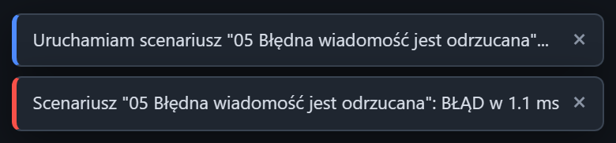

# Powiadomienia

[Spis treści](README.md) · Poprzednia: [Brak połączenia z serwerem](06-brak-polaczenia.md) · Następna: [Kafelek serwera](10-kafelek-serwera.md) <!-- nav -->

Krótkie komunikaty pojawiają się w prawym dolnym rogu ekranu po akcjach użytkownika i po ważnych
zmianach. Kolor paska po lewej stronie komunikatu oznacza jego wagę.

| Kolor | Rodzaj | Znika po |
|---|---|---|
| niebieski | informacja | 3,5 s |
| żółty | ostrzeżenie | 5 s |
| czerwony | błąd | 8 s |

Przycisk `×` zamyka komunikat od razu. Naraz widać najwyżej sześć komunikatów, najstarsze znikają
pierwsze.

## Przykłady

| Komunikat | Kiedy |
|---|---|
| Uruchamiam scenariusz „…” | kliknięcie **Uruchom** przy scenariuszu |
| Scenariusz „…”: OK w 63 ms (niebieski) albo BŁĄD (czerwony) | koniec scenariusza |
| Nasłuch default uruchomiony na 0.0.0.0:2575 | **Start** na kafelku serwera |
| Dodano nasłuch …, Zapisano nasłuch …, Usunięto nasłuch … | zmiany w formularzu serwera |
| Wypełniono cel na podstawie nasłuchu … | wybór pola **Cel** w panelu Klient |
| Załadowano: przykład adt_a01 | wybór przykładu albo **Wyślij ponownie** w inspektorze |
| Wysyłka: 3/5 OK, 2 nieudanych (żółty) | seria wysyłek z błędami |
| Tekst HL7: skopiowano (847 znaków) | przyciski kopiowania |
| Zdarzenie #N jest ukryte przez filtry, pokazano je w inspektorze | link do zdarzenia, którego filtr nie pokazuje |
| Eksport CSV rozpoczęty | wybór formatu w menu Eksport |
| Ustawienia zapisane | **Zapisz** w oknie ustawień |
| Treść wiadomości jest pusta (żółty) | **Wyślij** z pustym edytorem |

Powiadomienia nie są nigdzie zapisywane. Wszystko, co dotyczy ruchu HL7 (wiadomości, ACK, błędy
połączeń, wyniki scenariuszy), jest zawsze także na [osi czasu](40-os-czasu.md).

---

[Spis treści](README.md) · Poprzednia: [Brak połączenia z serwerem](06-brak-polaczenia.md) · Następna: [Kafelek serwera](10-kafelek-serwera.md) <!-- nav -->
