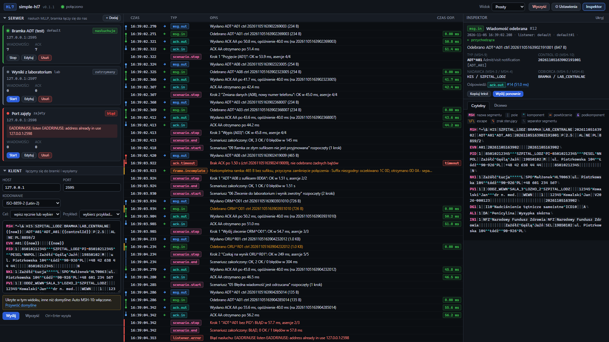
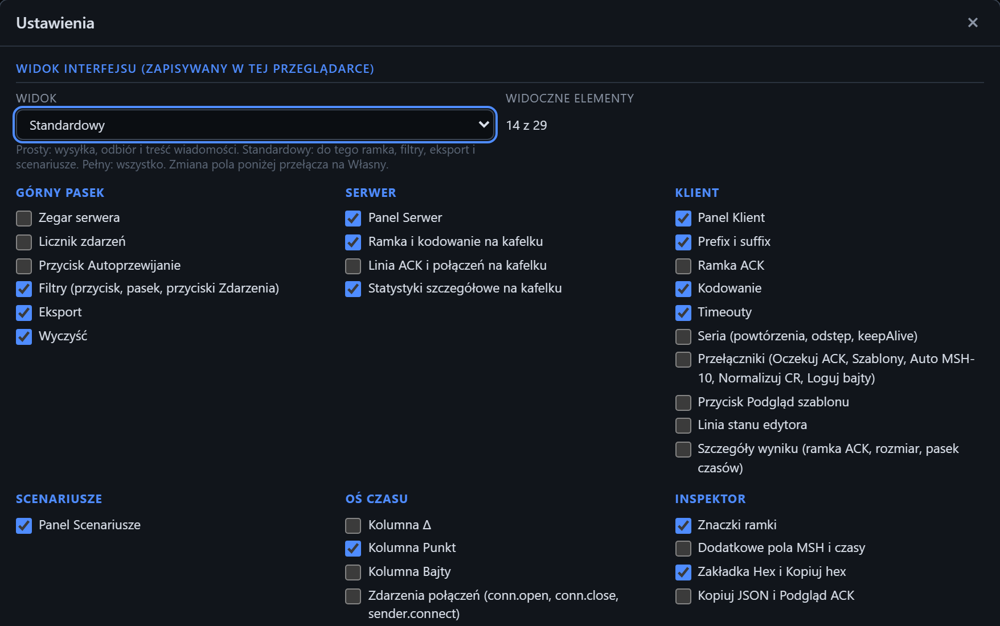

# Widok interfejsu

[Spis treści](README.md) · Poprzednia: [Powiadomienia](07-powiadomienia.md) · Następna: [Kafelek serwera](10-kafelek-serwera.md) <!-- nav -->

Widok decyduje, ile szczegółów pokazuje ekran. Program działa tak samo w każdym widoku: ukryty element
znika z ekranu, ale jego ustawienie nadal obowiązuje.

Widok wybiera się listą **Widok** w [górnym pasku](02-gorny-pasek.md) albo w [oknie Ustawienia](04-okno-ustawien.md).
Pozostałe strony instrukcji pokazują widok **Pełny**.

## Widoki

| Widok | Dla kogo | Co pokazuje |
|---|---|---|
| **Prosty** | pierwsze uruchomienie, szybkie sprawdzenie bramki | wysyłkę i odbiór wiadomości, ACK i treść wiadomości |
| **Standardowy** | codzienna praca z bramką | do tego ramkę (prefiks i sufiks), statystyki serwera, timeouty klienta, filtry, eksport, scenariusze, kolumnę Punkt i zakładkę Hex |
| **Pełny** | szukanie błędów ramki i analiza czasów | wszystko |
| **Własny** | każdy | dowolny zestaw elementów zaznaczony w oknie Ustawienia |

Przeglądarka, która otwiera program pierwszy raz, zaczyna w widoku **Prosty**. Przeglądarka, w której
program był już używany, zaczyna w widoku **Pełny**, więc dotychczasowy użytkownik widzi ten sam ekran
co wcześniej.

## Co ukrywa każdy widok

| Część ekranu | Prosty | Standardowy |
|---|---|---|
| Górny pasek: zegar, licznik zdarzeń, przycisk **Autoprzewijanie** | ukryte | ukryte |
| Górny pasek: **Filtry** (z paskiem filtrów i przyciskami **Zdarzenia**), **Eksport** | ukryte | widoczne |
| Kafelek serwera: ramka i kodowanie | ukryte | widoczne |
| Kafelek serwera: linia ACK i połączeń | ukryta | ukryta |
| Kafelek serwera: statystyki poza **Wiadomości** i **ACK** | ukryte | widoczne |
| Klient: prefiks i sufiks, timeouty | ukryte | widoczne |
| Klient: ramka ACK, seria wysyłek, przełączniki, **Podgląd szablonu**, linia stanu edytora | ukryte | ukryte |
| Wynik wysyłki: ramka ACK, rozmiar, pasek czasów | ukryte | ukryte |
| Panel **Scenariusze** | ukryty | widoczny |
| Oś czasu: kolumny **Δ** i **Bajty**, zdarzenia `conn.open`, `conn.close`, `sender.connect` | ukryte | ukryte |
| Oś czasu: kolumna **Punkt** | ukryta | widoczna |
| Inspektor: znaczki ramki, zakładka **Hex**, **Kopiuj hex** | ukryte | widoczne |
| Inspektor: dodatkowe pola MSH (wersja, czas, kodowanie, segmenty, rozmiar) i sekcje czasów, **Kopiuj JSON**, **Podgląd ACK** | ukryte | ukryte |

Widok **Pełny** nie ukrywa niczego. W każdym gotowym widoku zostają:

- stan połączenia, **Wyczyść**, **⚙ Ustawienia** i **Inspektor** w górnym pasku;
- kafelki serwera z nazwą, adresem, stanem, licznikami **Wiadomości** i **ACK** oraz przyciskami
  **+ Dodaj**, **Start** albo **Stop**, **Edytuj** i **Usuń**;
- w kliencie **Host**, **Port**, **Kodowanie**, **Cel**, **Przykład**, edytor, **Wyślij** i **Wyczyść**;
- na osi czasu kolumny **Czas**, **Typ**, **Opis** i **Czas odp.**, łańcuchy wiadomość i ACK oraz
  wszystkie błędy, także błędy połączeń;
- w inspektorze typ, control id, nadawca i odbiorca, ostrzeżenia, powiązany ACK, walidacja ACK,
  zakładki **Czytelny** i **Drzewo** oraz **Kopiuj tekst** i **Wyślij ponownie**.

Okna edycji (nowy nasłuch, edycja nasłuchu, podgląd ACK) są takie same w każdym widoku.

## Widok Własny

Okno **⚙ Ustawienia** ma na górze sekcję **Widok interfejsu**: listę widoków, licznik widocznych
elementów i 29 elementów w sześciu grupach (Górny pasek, Serwer, Klient, Scenariusze, Oś czasu,
Inspektor). Zaznaczony element jest widoczny.

- Wybór widoku z listy zaznacza jego elementy.
- Zmiana dowolnego pola przełącza listę na **Własny**.
- Ekran zmienia się od razu, jeszcze przed zapisem. **Zapisz** zachowuje widok, a **Anuluj**, `×`
  i `Esc` wracają do poprzedniego.
- Wybór **Własny** w górnym pasku przywraca ostatni zapisany własny zestaw. Za pierwszym razem zestaw
  zaczyna się od tego, co jest na ekranie, i od razu otwiera się okno Ustawienia.

## Ukryte pola klienta

Ukryte pole klienta nadal działa: jego wartość idzie w każdej wysyłce. Gdy ukryte pole ma wartość inną
niż domyślna, nad przyciskiem **Wyślij** pojawia się żółta linia z listą takich pól, na przykład
„Ukryte w tym widoku, inne niż domyślne: Auto MSH-10: włączone”. Link **Przywróć domyślne** ustawia
te pola na wartości domyślne, a gdy administrator zmienił domyślne ustawienia klienta w
`config/app.json`, na te wartości.

Gdy ukryte pole ma błędną wartość, na przykład prefiks `ZZ`, wysyłka się nie zaczyna, a
[powiadomienie](07-powiadomienia.md) podaje nazwę pola.

## Inne skutki widoku

- Widok bez filtrów czyści aktywne filtry osi czasu, żeby oś czasu nie była przefiltrowana bez
  widocznego powodu. Klawisz `/` nie otwiera wtedy paska filtrów.
- Gdy widok ukrywa zdarzenia połączeń, eksport bez filtra typów też je pomija, tak jak zdarzenia
  bajtów wyłączone w Ustawieniach.
- Link, który prowadzi do zdarzenia niewidocznego na osi czasu w tym widoku, otwiera to zdarzenie
  w inspektorze.

## Gdzie zapisuje się widok

Widok, razem z zestawem Własny, zapisuje się w pamięci tej przeglądarki. Inna przeglądarka albo inny
komputer ma swój widok.

---

[Spis treści](README.md) · Poprzednia: [Powiadomienia](07-powiadomienia.md) · Następna: [Kafelek serwera](10-kafelek-serwera.md) <!-- nav -->
