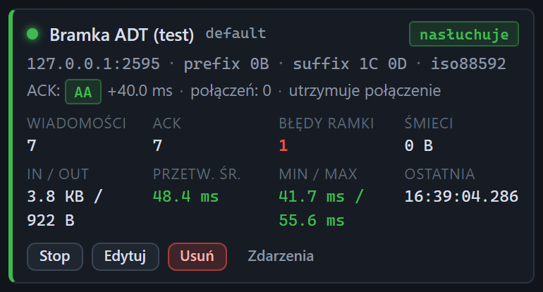

# Kafelek serwera

[Spis treści](README.md) · Poprzednia: [Widok interfejsu](08-widok.md) · Następna: [Stany kafelka serwera](11-stany-serwera.md) <!-- nav -->

> W widoku Prosty kafelek pokazuje nazwę, adres, stan, liczniki **Wiadomości** i **ACK** oraz przyciski. Widok Standardowy dodaje ramkę, kodowanie i pozostałe statystyki, a Pełny także linię ACK i połączeń, patrz [Widok interfejsu](08-widok.md).

Sekcja **Serwer** w lewej kolumnie ma jeden kafelek na każdy listener, czyli port, na którym tester
czeka na połączenia od bramki. Kafelek pokazuje konfigurację, stan i statystyki na żywo. Nowy listener
dodaje przycisk **+ Dodaj** w nagłówku sekcji, patrz [Formularz serwera](12-formularz-serwera.md).

## Nagłówek

| Element | Znaczenie |
|---|---|
| Kropka | stan w kolorze: zielona nasłuchuje, szara zatrzymany, żółta pulsująca uruchamianie, czerwona błąd |
| Nazwa (np. **Bramka ADT (test)**) | nazwa z formularza; gdy pusta, identyfikator |
| Identyfikator (np. `default`) | stały identyfikator listenera; pod nim zdarzenia tego listenera są widoczne na osi czasu w kolumnie Punkt |
| Znaczek stanu | **nasłuchuje**, **zatrzymany**, **uruchamianie** albo **błąd**, patrz [Stany kafelka](11-stany-serwera.md) |

## Linie konfiguracji

Pierwsza linia: `adres:port · prefix · suffix · kodowanie`.

| Fragment | Znaczenie |
|---|---|
| `127.0.0.1:2595` | adres i port nasłuchu. `0.0.0.0` oznacza wszystkie karty sieciowe serwera |
| `prefix 0B` | bajty, którymi bramka ma zaczynać każdą wiadomość |
| `suffix 1C 0D` | bajty, którymi bramka ma kończyć każdą wiadomość |
| `iso88592` | kodowanie, w którym listener czyta treść i pisze ACK |

Druga linia opisuje odpowiedź ACK i połączenia.

| Fragment | Znaczenie |
|---|---|
| **ACK:** znaczek trybu | `AA` zielony (przyjmuje), `AE` i `AR` czerwone (odrzuca), `none` żółty (nie odpowiada), `custom` niebieski (własny szablon) |
| `+40.0 ms` | celowe opóźnienie ACK; widoczne tylko, gdy większe od zera |
| `[0B / 1C 0D]` | ramka ACK; widoczna tylko, gdy różni się od ramki wejściowej |
| **połączeń: N** | ile połączeń TCP jest teraz otwartych do tego listenera |
| **utrzymuje połączenie** albo **zamyka po ACK** | czy po wysłaniu ACK listener zostawia połączenie otwarte |
| `, idle 30.00 s` | timeout bezczynności; widoczny tylko, gdy ustawiony |
| **bez bytes.*** | listener nie zapisuje zdarzeń pojedynczych fragmentów TCP |

## Statystyki

Liczniki obejmują czas od uruchomienia programu. Zatrzymanie i ponowny start listenera ich nie zerują,
restart programu tak.

| Pole | Znaczenie |
|---|---|
| **Wiadomości** | ile kompletnych ramek listener odebrał |
| **ACK** | ile ACK wysłał |
| **Błędy ramki** | ile ramek miało zły prefiks albo sufiks oraz ile niekompletnych ramek zgłosił. Wartość większa od zera jest czerwona |
| **Śmieci** | ile bajtów przyszło przed prefiksem ramki; większe od zera jest żółte |
| **In / Out** | ile bajtów listener odebrał i wysłał |
| **Przetw. śr.** | średni czas od odebrania kompletnej ramki do wysłania ACK, w kolorze według progów z Ustawień; zawiera celowe opóźnienie ACK |
| **Min / Max** | najkrótszy i najdłuższy czas przetwarzania; kolor według wartości maksymalnej |
| **Ostatnia** | godzina ostatniej odebranej wiadomości; pełna data po najechaniu |

Po najechaniu kursorem na każdą statystykę widać jej krótki opis.

## Przyciski

| Przycisk | Działanie |
|---|---|
| **Stop** (gdy nasłuchuje) | zatrzymuje nasłuch i zamyka otwarte połączenia; bramka dostanie odmowę połączenia |
| **Start** (gdy zatrzymany albo błąd) | uruchamia nasłuch na skonfigurowanym porcie |
| **Edytuj** | otwiera [formularz edycji](13-formularz-serwera-ack.md) |
| **Usuń** | usuwa listener po potwierdzeniu, patrz [Usuwanie serwera](14-usuwanie-serwera.md) |
| **Zdarzenia** | otwiera pasek filtrów i pokazuje na osi czasu tylko zdarzenia tego listenera |

W trakcie operacji (start, stop, usuwanie) przyciski są chwilowo nieaktywne. Wynik pokazuje
[powiadomienie](07-powiadomienia.md).

## Na co patrzeć podczas testu

- **Błędy ramki rosną:** bramka wysyła inny prefiks albo sufiks niż ustawiony. Szczegóły pokazuje
  zdarzenie [Niekompletna ramka](59-niekompletna-ramka.md) albo czerwony znaczek przy wiadomości.
- **Wiadomości rosną, a ACK nie:** tryb ACK `none` albo błąd budowy ACK; sprawdź oś czasu.
- **połączeń: 0, a bramka twierdzi, że wysyła:** bramka nie dociera do portu. Sprawdź adres, port
  i firewall serwera.
- **Przetw. śr. wysoki bez ustawionego opóźnienia:** serwer testera jest przeciążony; wyłącz
  zdarzenia bajtów albo zmniejsz ruch.

---

[Spis treści](README.md) · Poprzednia: [Widok interfejsu](08-widok.md) · Następna: [Stany kafelka serwera](11-stany-serwera.md) <!-- nav -->
