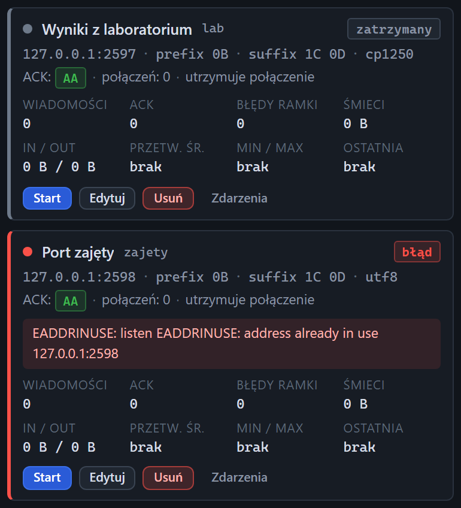

# Stany kafelka serwera

[Spis treści](README.md) · Poprzednia: [Kafelek serwera](10-kafelek-serwera.md) · Następna: [Formularz serwera: dodawanie](12-formularz-serwera.md) <!-- nav -->

Listener może być w jednym z czterech stanów. Stan widać po kolorze kropki i ramki kafelka, po znaczku
w prawym górnym rogu i po dostępnych przyciskach.

| Stan | Wygląd | Co znaczy | Główny przycisk |
|---|---|---|---|
| **nasłuchuje** | zielona kropka i ramka | port jest otwarty, bramka może się łączyć | **Stop** |
| **zatrzymany** | szara kropka i ramka | port zamknięty; bramka dostanie odmowę połączenia | **Start** (niebieski) |
| **uruchamianie** | żółta pulsująca kropka | trwa otwieranie portu, zwykle ułamek sekundy | **Stop** |
| **błąd** | czerwona kropka i ramka, czerwone pole z komunikatem | nie udało się otworzyć portu | **Start** (niebieski) |

## Kiedy listener jest zatrzymany

- Ktoś kliknął **Stop**.
- Listener ma wyłączone pole **Uruchamiaj automatycznie** i program dopiero wystartował.
- Listener został dodany z wyłączonym automatycznym startem.

## Błąd i jego komunikat

Pole z komunikatem pokazuje powód z systemu operacyjnego. Najczęstsze:

| Komunikat | Przyczyna | Co zrobić |
|---|---|---|
| `EADDRINUSE ... address already in use 127.0.0.1:2598` | port zajmuje inny program, np. druga kopia testera, sama bramka albo inna usługa | znajdź proces: `netstat -ano \| findstr :2598` (Windows) albo `ss -ltnp \| grep 2598` (Linux); zwolnij port albo zmień port w **Edytuj** |
| `EACCES` | brak uprawnień do portu, zwykle port poniżej 1024 na Linuksie | użyj portu 1024 lub wyższego |
| `EADDRNOTAVAIL` | w polu Host jest adres, którego serwer nie ma | wpisz `0.0.0.0` albo właściwy adres karty sieciowej |

Po usunięciu przyczyny kliknij **Start**. Błąd startu jest też zapisany na osi czasu jako zdarzenie
**Błąd nasłuchu** (`listener.error`), a pozostałe listenery i reszta programu działają normalnie.

## Zobacz też

- [Kafelek serwera](10-kafelek-serwera.md): opis wszystkich pól i statystyk.
- [Formularz serwera](12-formularz-serwera.md): zmiana portu, adresu i automatycznego startu.

---

[Spis treści](README.md) · Poprzednia: [Kafelek serwera](10-kafelek-serwera.md) · Następna: [Formularz serwera: dodawanie](12-formularz-serwera.md) <!-- nav -->
