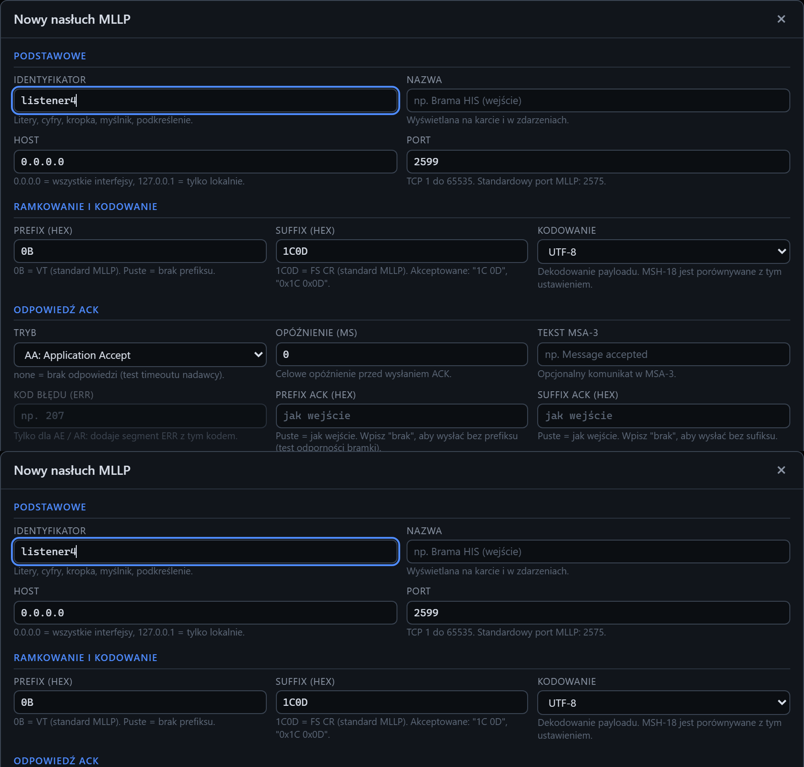

# Formularz serwera: dodawanie

[Spis treści](README.md) · Poprzednia: [Stany kafelka serwera](11-stany-serwera.md) · Następna: [Formularz serwera: edycja i własny ACK](13-formularz-serwera-ack.md) <!-- nav -->

Okno **Nowy nasłuch MLLP** otwiera przycisk **+ Dodaj** w nagłówku sekcji Serwer. Dodaje kolejny
listener, czyli kolejny port, na którym tester czeka na bramkę. Kilka listenerów przydaje się, gdy
bramka wysyła różne strumienie na różne porty (np. ADT na 2575, wyniki na 2576) albo gdy trzeba
porównać dwie konfiguracje ramki lub kodowania.

Formularz proponuje wolny identyfikator (`listener4`) i port o jeden wyższy od największego
używanego.

## Podstawowe

| Pole | Domyślnie | Znaczenie |
|---|---|---|
| **Identyfikator** | `listenerN` | stała nazwa techniczna: litery, cyfry, kropka, myślnik, podkreślenie. Widać ją na osi czasu w kolumnie Punkt. Po zapisaniu nie da się jej zmienić |
| **Nazwa** | pusta | nazwa wyświetlana na kafelku, np. „Wyniki z laboratorium”. Pusta oznacza identyfikator |
| **Host** | `0.0.0.0` | na jakim adresie serwera nasłuchiwać. `0.0.0.0`: wszystkie karty sieciowe (bramka na innej maszynie). `127.0.0.1`: tylko połączenia z tego samego serwera |
| **Port** | kolejny wolny | port TCP od 1 do 65535. Standardowy port MLLP to 2575. Port musi być wolny i otwarty na firewallu |

## Ramkowanie i kodowanie

| Pole | Domyślnie | Znaczenie |
|---|---|---|
| **Prefix (hex)** | `0B` | bajty, którymi bramka zaczyna wiadomość. `0B` to znak VT, standard MLLP. Puste pole: bramka wysyła bez prefiksu |
| **Suffix (hex)** | `1C0D` | bajty, którymi bramka kończy wiadomość. `1C0D` to znaki FS i CR, standard MLLP. Listener uznaje wiadomość za kompletną dopiero po tych bajtach |
| **Kodowanie** | UTF-8 | jak czytać bajty treści i jak zapisać ACK: UTF-8, CP1250 (Windows-1250), ISO-8859-2 (Latin-2), ISO-8859-1 (Latin-1), Windows-1252, ASCII. Listener porównuje je z deklaracją w MSH-18 i ostrzega o niezgodności |

Hex można wpisać jako `1C0D`, `1c0d`, `1C 0D`, `0x1C 0x0D` albo `1C,0D`. Nieprawidłowe znaki albo
nieparzysta liczba cyfr dają błąd pod polem.

## Odpowiedź ACK

| Pole | Domyślnie | Znaczenie |
|---|---|---|
| **Tryb** | AA | `AA: Application Accept`: przyjmuje każdą wiadomość. `AE: Application Error` i `AR: Application Reject`: odrzuca każdą wiadomość, do testu obsługi odrzuceń w bramce. `none`: nie odsyła ACK, do testu timeoutu i ponowień w bramce. `custom`: wysyła ACK z własnego szablonu, patrz [edycja i własny ACK](13-formularz-serwera-ack.md) |
| **Opóźnienie (ms)** | 0 | czas oczekiwania przed wysłaniem ACK, do sprawdzenia, jak bramka reaguje na wolnego odbiorcę |
| **Tekst MSA-3** | pusty | tekst w polu MSA-3 ACK, np. opis błędu przy AE |
| **Kod błędu (ERR)** | pusty | tylko dla AE i AR: dodaje segment ERR z tym kodem (np. 207). Format zależy od wersji wiadomości: przed 2.5 `ERR|^^^kod&tekst`, od 2.5 `ERR|||kod^tekst^HL70357|E`. Przy innych trybach pole jest wyszarzone |
| **Prefix ACK (hex)** | jak wejście | ramka ACK, gdy ma być inna niż ramka wiadomości. Puste: taka sama jak wejście. `brak`: ACK bez prefiksu |
| **Suffix ACK (hex)** | jak wejście | jak wyżej dla sufiksu. Celowo zła ramka ACK (np. `0D0A`) sprawdza, czy bramka wykryje błędny ACK |

## Zaawansowane

| Pole | Domyślnie | Znaczenie |
|---|---|---|
| **Limit wiadomości (B)** | 10485760 (10 MB) | ramka większa niż limit jest odrzucana, a na osi czasu pojawia się błąd połączenia `E_MAX_SIZE` |
| **Timeout bezczynności (ms)** | 0 (wyłączony) | po tylu milisekundach ciszy listener zamyka połączenie; bajty niedokończonej ramki zgłasza jako niekompletną ramkę |
| **Timeout ramki (ms)** | 3000 | po tylu milisekundach ciszy w trakcie odbioru ramki bez sufiksu listener zgłasza ją jako [niekompletną](59-niekompletna-ramka.md), a połączenie zostaje otwarte. Dzięki temu zły sufiks bramki widać od razu, bez czekania na rozłączenie. 0 wyłącza |
| **Utrzymuj połączenie po ACK** | włączone | wyłączone: listener zamyka połączenie po każdym ACK, tak jak robią niektóre systemy |
| **Uruchamiaj automatycznie** | włączone | listener startuje przy uruchomieniu programu i od razu po dodaniu |
| **Loguj zdarzenia bytes.in / bytes.out** | włączone | zapisuje każdy fragment TCP jako osobne zdarzenie; przy dużym ruchu warto wyłączyć |

## Przyciski

| Przycisk | Działanie |
|---|---|
| **Dodaj i uruchom** | sprawdza pola, dodaje listener do konfiguracji i uruchamia go (gdy zaznaczone jest **Uruchamiaj automatycznie**). `Enter` w dowolnym polu działa tak samo |
| **Anuluj**, `×`, `Esc` | zamyka okno bez zmian |

Błędy pól pokazują się pod polami, a nad przyciskami komunikat „Popraw zaznaczone pola.”. Błąd
programu, np. port już używany przez inny listener, okno pokazuje nad przyciskami i nie zamyka się.

Nowy listener trafia do pliku `config/app.json` i zostaje po restarcie programu.

---

[Spis treści](README.md) · Poprzednia: [Stany kafelka serwera](11-stany-serwera.md) · Następna: [Formularz serwera: edycja i własny ACK](13-formularz-serwera-ack.md) <!-- nav -->
