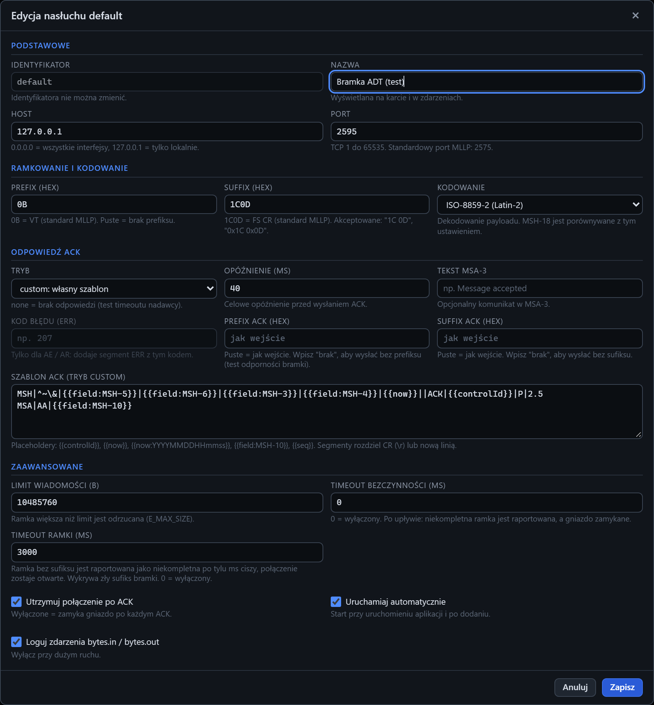

# Formularz serwera: edycja i własny ACK

[Spis treści](README.md) · Poprzednia: [Formularz serwera: dodawanie](12-formularz-serwera.md) · Następna: [Usuwanie serwera](14-usuwanie-serwera.md) <!-- nav -->



Okno **Edycja nasłuchu &lt;identyfikator&gt;** otwiera przycisk **Edytuj** na kafelku serwera. Ma te same
pola co [formularz dodawania](12-formularz-serwera.md), wypełnione bieżącą konfiguracją. Różnice:

- **Identyfikator** jest zablokowany; tej nazwy nie da się zmienić. Inną nazwę wyświetlaną ustawia pole **Nazwa**.
- Przycisk zapisu nazywa się **Zapisz**.
- Pole **Szablon ACK (tryb custom)** jest widoczne tylko w trybie `custom`.

## Kiedy zmiana restartuje listener

| Zmiana | Skutek |
|---|---|
| Host, Port, Prefix, Suffix, Kodowanie | listener zatrzymuje się i startuje ponownie z nowymi ustawieniami. Otwarte połączenia zostaną zamknięte, więc bramka musi połączyć się ponownie |
| Tryb ACK, opóźnienie, tekst, kod błędu, ramka ACK, szablon, timeouty, utrzymywanie połączenia, zdarzenia bajtów | działa od następnej wiadomości, bez przerywania połączeń |

## Własny ACK (tryb custom)

Tryb `custom` wysyła na każdą wiadomość ACK zbudowany z szablonu. Służy do testów, których nie da się
zrobić standardowym ACK, np.:

- ACK z innym MSA-2 niż MSH-10 wiadomości: czy bramka wykryje, że potwierdzenie dotyczy innej wiadomości,
- ACK z błędnym typem w MSH-9 albo bez segmentu MSA,
- ACK z dodatkowymi segmentami, których wymaga konkretny system.

Szablon zapisuje się tak jak wiadomość HL7: każdy segment w osobnej linii. Program zamienia nowe linie
na CR i dodaje CR na końcu, poza tym wysyła tekst dokładnie tak, jak go zapisano, więc może to być
również celowo niepoprawny ACK. Pusty szablon w trybie `custom` jest błędem formularza („Tryb custom
wymaga szablonu.”).

### Placeholdery w szablonie

| Placeholder | Wynik |
|---|---|
| `{{field:MSH-10}}` | wartość pola z odebranej wiadomości; dowolna ścieżka, np. `{{field:MSH-3}}`, `{{field:PID-3.1}}` |
| `{{controlId}}` | nowy identyfikator ACK, 20 znaków |
| `{{now}}` | bieżący czas `YYYYMMDDHHmmss` |
| `{{now:FORMAT}}` | czas w podanym formacie, np. `{{now:YYYYMMDD}}` |
| `{{seq}}` | kolejny numer od 1 |

Przykład z zrzutu: standardowy ACK zbudowany ręcznie, z zamianą nadawcy i odbiorcy.

```
MSH|^~\&|{{field:MSH-5}}|{{field:MSH-6}}|{{field:MSH-3}}|{{field:MSH-4}}|{{now}}||ACK|{{controlId}}|P|2.5
MSA|AA|{{field:MSH-10}}
```

Przed zapisaniem szablonu można sprawdzić, co z niego powstanie: otwórz w inspektorze dowolną
odebraną wiadomość i użyj [Podglądu ACK](62-podglad-ack.md).

---

[Spis treści](README.md) · Poprzednia: [Formularz serwera: dodawanie](12-formularz-serwera.md) · Następna: [Usuwanie serwera](14-usuwanie-serwera.md) <!-- nav -->
