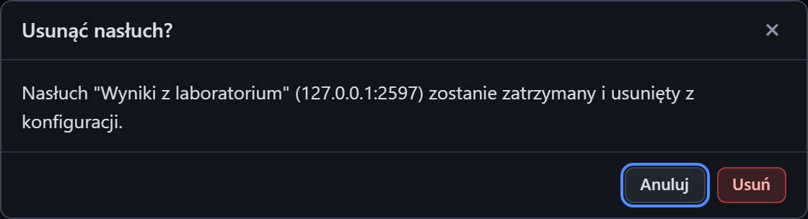

# Usuwanie serwera

[Spis treści](README.md) · Poprzednia: [Formularz serwera: edycja i własny ACK](13-formularz-serwera-ack.md) · Następna: [Formularz klienta](20-formularz-klienta.md) <!-- nav -->

Przycisk **Usuń** na kafelku serwera otwiera okno potwierdzenia z nazwą, adresem i portem listenera.

## Przyciski okna

| Przycisk | Działanie |
|---|---|
| **Usuń** (czerwony) | zatrzymuje listener, zamyka jego połączenia i usuwa go z pliku `config/app.json`. Kafelek znika |
| **Anuluj**, `×`, `Esc` | zamyka okno bez zmian |

## Co zostaje

- Zdarzenia tego listenera na osi czasu, w eksporcie i w pliku `logs/events.ndjson`.
- Inne listenery i ich połączenia.

Usunięcia nie da się cofnąć. Żeby przywrócić listener, dodaj go ponownie przez **+ Dodaj** z tymi
samymi ustawieniami. Jeśli chcesz tylko chwilowo przestać przyjmować ruch, użyj **Stop** zamiast **Usuń**.

---

[Spis treści](README.md) · Poprzednia: [Formularz serwera: edycja i własny ACK](13-formularz-serwera-ack.md) · Następna: [Formularz klienta](20-formularz-klienta.md) <!-- nav -->
