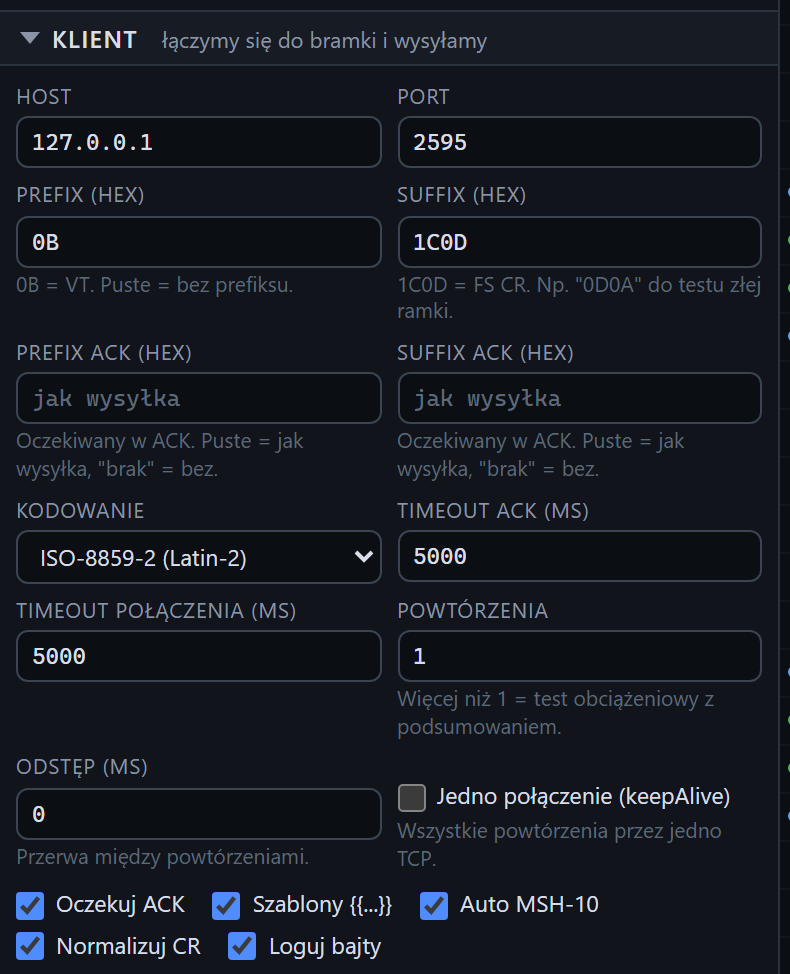

# Formularz klienta

[Spis treści](README.md) · Poprzednia: [Usuwanie serwera](14-usuwanie-serwera.md) · Następna: [Edytor wiadomości](21-edytor-wiadomosci.md) <!-- nav -->

Sekcja **Klient** w lewej kolumnie wysyła wiadomości do bramki. Tester sam łączy się z bramką,
wysyła wiadomość w ramce MLLP i czeka na ACK. Górna część sekcji to ustawienia połączenia opisane
na tej stronie. Pod nimi jest [edytor wiadomości](21-edytor-wiadomosci.md), a jeszcze niżej
pojawia się [wynik wysyłki](23-wynik-wysylki.md).

Formularz zapamiętuje się w przeglądarce. Przy pierwszym otwarciu wypełniają go domyślne ustawienia
klienta z konfiguracji programu.

## Adres i ramka

| Pole | Domyślnie | Znaczenie |
|---|---|---|
| **Host** | `127.0.0.1` | adres IP albo nazwa bramki, osiągalna z serwera, na którym działa tester (nie z twojego komputera) |
| **Port** | 2575 | port, na którym bramka przyjmuje wiadomości |
| **Prefix (hex)** | `0B` | bajty przed treścią wiadomości. Puste pole: bez prefiksu |
| **Suffix (hex)** | `1C0D` | bajty po treści. Celowo zły sufiks, np. `0D0A`, sprawdza, czy bramka odrzuci źle zakończoną ramkę |
| **Prefix ACK (hex)** | jak wysyłka | jakiego prefiksu tester oczekuje w ACK. Puste: taki sam jak w wysyłce. `brak`: ACK bez prefiksu |
| **Suffix ACK (hex)** | jak wysyłka | jakiego sufiksu oczekuje w ACK. Gdy bramka odpowiada inną ramką, ustaw ją tutaj, inaczej tester nie rozpozna końca ACK i zgłosi brak odpowiedzi |

Hex można wpisać jako `1C0D`, `1C 0D`, `0x1C 0x0D` albo `1C,0D`.

## Kodowanie i czasy

| Pole | Domyślnie | Znaczenie |
|---|---|---|
| **Kodowanie** | UTF-8 | w jakim kodowaniu wysłać treść i czytać ACK: UTF-8, CP1250, ISO-8859-2, ISO-8859-1, Windows-1252, ASCII. Ustaw takie, jakiego bramka oczekuje; zwykle zgodne z polem MSH-18 wiadomości |
| **Timeout ACK (ms)** | 5000 | jak długo czekać na kompletny ACK po wysłaniu wiadomości. Po tym czasie wynik to „Brak ACK” |
| **Timeout połączenia (ms)** | 5000 | jak długo czekać na nawiązanie połączenia TCP z bramką |

## Powtórzenia

| Pole | Domyślnie | Znaczenie |
|---|---|---|
| **Powtórzenia** | 1 | ile razy wysłać wiadomość. Więcej niż 1 daje [wynik serii](25-wynik-serii.md) z czasami minimalnym, średnim, maksymalnym i p95 |
| **Odstęp (ms)** | 0 | przerwa między kolejnymi wysyłkami w serii |
| **Jedno połączenie (keepAlive)** | wyłączone | wszystkie wysyłki serii idą jednym połączeniem TCP, tak jak robi to większość systemów HIS. Wyłączone: każda wysyłka otwiera nowe połączenie |

## Przełączniki

| Przełącznik | Domyślnie | Znaczenie |
|---|---|---|
| **Oczekuj ACK** | włączony | wyłączony: tester wysyła wiadomość i nie czeka na odpowiedź. Wynik to wtedy „wysłano bez oczekiwania na ACK” |
| **Szablony {{...}}** | włączony | podstawia placeholdery w treści (`{{controlId}}`, `{{now}}` i inne, patrz [edytor](21-edytor-wiadomosci.md)). Wyłączony: tekst idzie dosłownie |
| **Auto MSH-10** | wyłączony | podmienia MSH-10 na nowy identyfikator przy każdej wysyłce, także w każdej wysyłce serii. Bramki często odrzucają powtórzony control id, więc przy wielokrotnym wysyłaniu tej samej wiadomości warto go włączyć |
| **Normalizuj CR** | włączony | zamienia separatory segmentów (nowe linie, CRLF) na CR i dodaje CR na końcu, jak wymaga HL7. Wyłącz, żeby celowo wysłać wiadomość z LF i sprawdzić reakcję bramki |
| **Loguj bajty** | włączony | zapisuje fragmenty TCP tej wysyłki jako zdarzenia bajtów (widoczne po włączeniu ich w Ustawieniach) |

## Walidacja

Przed wysłaniem formularz sprawdza: host nie może być pusty, port od 1 do 65535, pola hex tylko
z cyfr `0-9` i liter `A-F` w parzystej liczbie, powtórzenia co najmniej 1, czasy nieujemne, treść
niepusta. Błąd pokazuje się pod polem, a wysyłka nie rusza.

## Wskazówki

- Do szybkiego autotestu bez bramki wybierz w polu **Cel** pod formularzem własny listener testera.
  Host, port, ramka i kodowanie wypełnią się same.
- Gdy bramka nie odpowiada, a w zdarzeniu brak ACK widać jakieś bajty, bramka odpowiada inną ramką.
  Ustaw ją w polach **Prefix ACK** i **Suffix ACK**.

---

[Spis treści](README.md) · Poprzednia: [Usuwanie serwera](14-usuwanie-serwera.md) · Następna: [Edytor wiadomości](21-edytor-wiadomosci.md) <!-- nav -->
