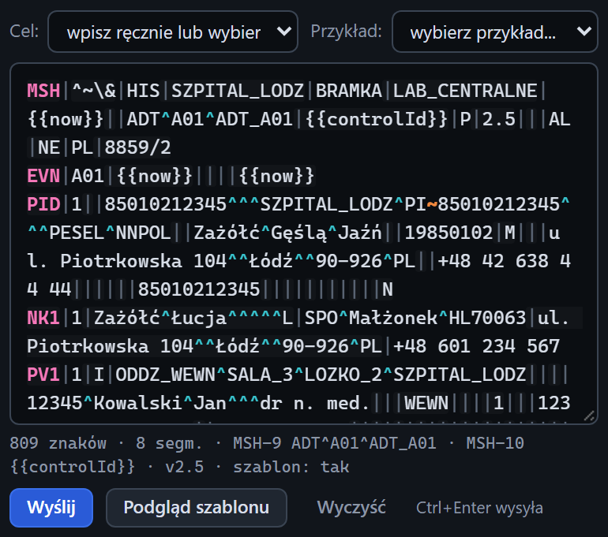

# Edytor wiadomości

[Spis treści](README.md) · Poprzednia: [Formularz klienta](20-formularz-klienta.md) · Następna: [Podgląd wiadomości](22-podglad-wiadomosci.md) <!-- nav -->

> Linię stanu i przycisk **Podgląd szablonu** pokazuje widok Pełny, patrz [Widok interfejsu](08-widok.md).

Dolna część sekcji Klient to miejsce na treść wiadomości HL7 i przyciski wysyłki.

## Elementy

| Element | Działanie |
|---|---|
| **Cel:** | lista listenerów tego testera. Wybór wypełnia formularz adresem `127.0.0.1`, portem, ramką, kodowaniem i ramką ACK wybranego listenera. Służy do autotestu bez bramki. Pole wraca potem do napisu „wpisz ręcznie lub wybierz nasłuch...” |
| **Przykład:** | lista przykładowych wiadomości z katalogu `examples/` obok programu, z opisem każdej. Wybór zastępuje treść edytora wybranym przykładem |
| Edytor | treść wiadomości. Każdy segment w osobnej linii; separatory zamieniają się na CR przy wysyłce (przełącznik **Normalizuj CR**). Kolory są takie same jak w zakładce [Czytelny](52-zakladka-czytelny.md) inspektora i odświeżają się podczas pisania |
| Linia stanu | pod edytorem: liczba znaków, liczba segmentów, typ wiadomości z MSH-9, control id z MSH-10, wersja z MSH-12 oraz „szablon: tak” albo „szablon: wyłączony”, gdy treść ma placeholdery. Żółty napis „brak segmentu MSH na początku” ostrzega, że to nie jest poprawna wiadomość HL7 |
| **Wyślij** | wysyła wiadomość z ustawieniami z formularza. Skrót: `Ctrl+Enter` w edytorze. W trakcie wysyłki przycisk jest nieaktywny i ma napis „Wysyłanie...” |
| **Podgląd szablonu** | pokazuje treść po podstawieniu placeholderów, bez wysyłania, patrz [Podgląd wiadomości](22-podglad-wiadomosci.md) |
| **Wyczyść** | czyści treść edytora, bez potwierdzenia |

## Skąd wziąć treść

- Wpisać albo wkleić, np. wiadomość z logu bramki lub od klienta.
- Wybrać z listy **Przykład**. Własne przykłady to pliki `.hl7` w katalogu `examples/`; pierwsza linia
  zaczynająca się od `#` jest opisem na liście.
- Przyciskiem **Wyślij ponownie** w inspektorze: wiadomość z osi czasu trafia do edytora.
- Przyciskiem **Załaduj do nadawcy** w [Podglądzie ACK](62-podglad-ack.md).

## Placeholdery

Gdy włączony jest przełącznik **Szablony {{...}}**, program podstawia przed wysłaniem:

| Placeholder | Wynik |
|---|---|
| `{{controlId}}` | nowy identyfikator, 20 znaków; w całej wiadomości ta sama wartość |
| `{{now}}` | bieżący czas `YYYYMMDDHHmmss` |
| `{{now:FORMAT}}` | czas w formacie z tokenami `YYYY MM DD HH mm ss SSS`, np. `{{now:YYYYMMDD}}` |
| `{{seq}}` | kolejny numer od 1, rośnie z każdą wiadomością |

Przykłady z katalogu `examples/` mają `{{controlId}}` w MSH-10 i `{{now}}` w MSH-7, więc każda wysyłka
dostaje świeży identyfikator i czas.

Treść edytora przeglądarka zapamiętuje razem z formularzem (do 200 000 znaków).

---

[Spis treści](README.md) · Poprzednia: [Formularz klienta](20-formularz-klienta.md) · Następna: [Podgląd wiadomości](22-podglad-wiadomosci.md) <!-- nav -->
