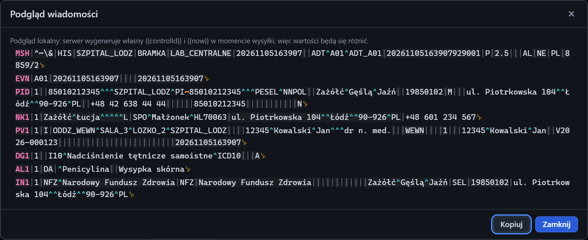

# Podgląd wiadomości

[Spis treści](README.md) · Poprzednia: [Edytor wiadomości](21-edytor-wiadomosci.md) · Następna: [Wynik wysyłki](23-wynik-wysylki.md) <!-- nav -->

> Przycisk **Podgląd szablonu** jest w widoku Pełny, patrz [Widok interfejsu](08-widok.md).

Okno otwiera przycisk **Podgląd szablonu** pod edytorem w sekcji Klient. Pokazuje, jak wiadomość
będzie wyglądać po podstawieniu placeholderów, zanim zostanie wysłana.

## Zawartość

| Element | Znaczenie |
|---|---|
| Notatka na górze | przy włączonych szablonach przypomina, że to podgląd lokalny: program w chwili wysyłki wygeneruje własny `{{controlId}}` i `{{now}}`, więc wartości będą inne niż w podglądzie. Przy wyłączonych szablonach mówi, że wiadomość pójdzie dosłownie |
| Treść | wiadomość z kolorowaniem jak w zakładce [Czytelny](52-zakladka-czytelny.md). Na końcu każdego segmentu jest symbol separatora |
| Błąd renderowania | czerwony komunikat, gdy szablonu nie da się przetworzyć |

## Przyciski

| Przycisk | Działanie |
|---|---|
| **Kopiuj** | kopiuje treść po podstawieniu do schowka |
| **Zamknij**, `×`, `Esc` | zamyka okno |

Podgląd niczego nie wysyła. Służy do sprawdzenia, czy placeholdery są poprawnie zapisane
(niepoprawny albo nieznany placeholder zostaje w treści dosłownie, np. `{{nowx}}`) i czy pola trafiają
na właściwe pozycje.

---

[Spis treści](README.md) · Poprzednia: [Edytor wiadomości](21-edytor-wiadomosci.md) · Następna: [Wynik wysyłki](23-wynik-wysylki.md) <!-- nav -->
