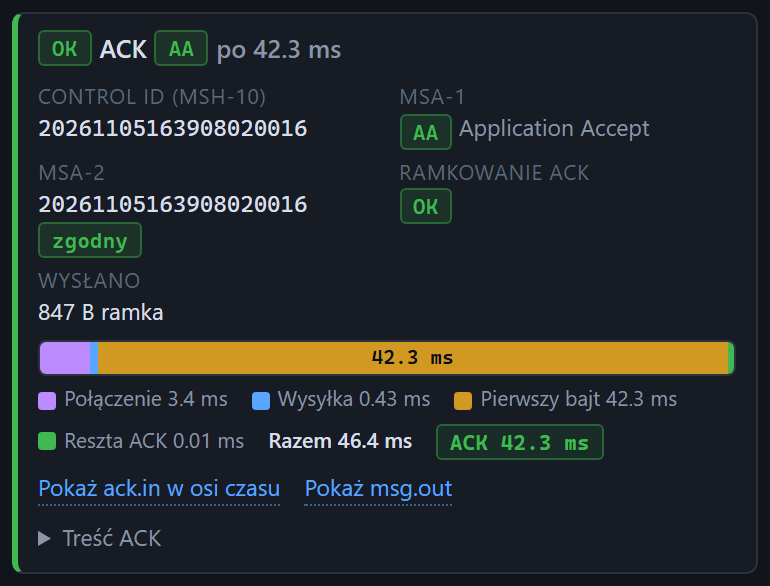

# Wynik wysyłki

[Spis treści](README.md) · Poprzednia: [Podgląd wiadomości](22-podglad-wiadomosci.md) · Następna: [Wynik wysyłki: błąd](24-wynik-wysylki-blad.md) <!-- nav -->

> Widoki Prosty i Standardowy pokazują w wyniku ACK, MSA-1 i MSA-2, a ukrywają ramkę ACK, rozmiar i pasek czasów, patrz [Widok interfejsu](08-widok.md).

Po kliknięciu **Wyślij** pod przyciskami pojawia się karta wyniku. W trakcie wysyłki pokazuje napis
„Wysyłanie do host:port...”, po zakończeniu wynik pojedynczej wysyłki. Wynik serii opisuje
[osobna strona](25-wynik-serii.md).

## Nagłówek

| Element | Znaczenie |
|---|---|
| **OK** (zielony) | wymiana się udała: połączenie, wysyłka i kompletny ACK w czasie |
| **BŁĄD** (czerwony) | wymiana się nie udała, patrz [Wynik wysyłki: błąd](24-wynik-wysylki-blad.md) |
| **ACK** ze znaczkiem kodu | kod z MSA-1: zielony dla `AA` i `CA` (przyjęte), czerwony dla pozostałych |
| „po 47.0 ms” | czas odpowiedzi bramki: od wysłania wiadomości do kompletnego ACK |

**OK nie oznacza, że bramka przyjęła wiadomość.** OK oznacza tylko, że przyszedł ACK. Bramka może
odpowiedzieć `AE` albo `AR`, wtedy nagłówek jest zielony, a znaczek kodu czerwony.

## Pola

| Pole | Znaczenie |
|---|---|
| **Control ID (MSH-10)** | identyfikator wysłanej wiadomości (po podmianie przez Auto MSH-10 albo `{{controlId}}`) |
| **MSA-1** | kod potwierdzenia z opisem: `AA` Application Accept, `AE` Application Error, `AR` Application Reject, `CA`, `CE`, `CR` odpowiedniki przy potwierdzeniach na poziomie transportu |
| **MSA-2** | control id, który bramka potwierdziła, i znaczek **zgodny** albo **NIEZGODNY** z wysłanym MSH-10. Niezgodny oznacza, że ACK dotyczy innej wiadomości |
| **MSA-3** | tekst z ACK, jeśli bramka go podała (zwykle opis błędu) |
| **Ramkowanie ACK** | **OK** albo **BŁĄD**; przy błędzie obok faktyczny prefiks i sufiks ACK |
| **Wysłano** | rozmiar wysłanej ramki w bajtach, z prefiksem i sufiksem |

## Pasek czasów

Pasek dzieli czas wysyłki na odcinki. Długość odcinka jest proporcjonalna do czasu, a liczby są
w legendzie pod paskiem.

| Odcinek | Kolor | Od | Do |
|---|---|---|---|
| **Połączenie** | fioletowy | start wysyłki | nawiązane połączenie TCP |
| **Wysyłka** | niebieski | nawiązane połączenie | wypchnięta cała ramka |
| **Pierwszy bajt** | żółty | wypchnięta ramka | pierwszy bajt odpowiedzi bramki |
| **Reszta ACK** | zielony | pierwszy bajt | kompletny ACK z sufiksem |

**Razem** to łączny czas wysyłki. Znaczek **ACK N ms** to czas odpowiedzi bramki, kolorowany według
progów z [Ustawień](04-okno-ustawien.md). Ten czas porównuje się z SLA.

## Lista problemów

Gdy walidacja ACK coś wykryła, pod paskiem pojawia się lista, np. „MSA-1 ma wartość AE, oczekiwano AA
lub CA (MSA-3: …)”, „MSA-2 (…) nie zgadza się z wysłanym MSH-10 (…)”, „Sufiks ACK niezgodny”.

## Linki i treść ACK

| Element | Działanie |
|---|---|
| **Pokaż ack.in w osi czasu** | zaznacza ACK na osi czasu i otwiera go w [inspektorze](57-ack-otrzymany.md) |
| **Pokaż msg.out** | zaznacza wysłaną wiadomość, patrz [Wiadomość wysłana](56-wiadomosc-wyslana.md) |
| **Treść ACK** | rozwija pokolorowaną treść ACK bezpośrednio na karcie |

---

[Spis treści](README.md) · Poprzednia: [Podgląd wiadomości](22-podglad-wiadomosci.md) · Następna: [Wynik wysyłki: błąd](24-wynik-wysylki-blad.md) <!-- nav -->
