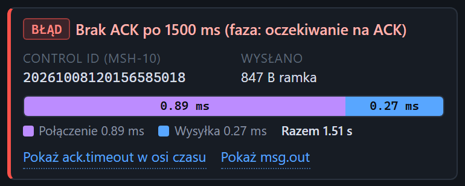

# Wynik wysyłki: błąd

[Spis treści](README.md) · Poprzednia: [Wynik wysyłki](23-wynik-wysylki.md) · Następna: [Wynik serii wysyłek](25-wynik-serii.md) <!-- nav -->

Gdy wymiana się nie uda, karta wyniku ma czerwony znaczek **BŁĄD**, opis błędu i fazę, w której
wystąpił. Pasek czasów pokazuje odcinki, które zdążyły się wykonać. Na zrzucie połączenie i wysyłka
się udały, a ACK nie przyszedł.

## Fazy

| Faza | Co się nie udało |
|---|---|
| **łączenie** | nie udało się otworzyć połączenia TCP z bramką |
| **wysyłka** | połączenie było, ale wiadomość nie wyszła w całości |
| **oczekiwanie na ACK** | wiadomość wyszła, ale kompletny ACK nie przyszedł |

## Najczęstsze komunikaty

| Komunikat | Faza | Przyczyna i co sprawdzić |
|---|---|---|
| Brak ACK po N ms | oczekiwanie na ACK | bramka nie odpowiedziała w czasie z pola **Timeout ACK**. Najczęściej bramka nie rozpoznała końca naszej ramki (zły **Suffix**) albo odpowiedziała inną ramką niż oczekiwana. Otwórz zdarzenie przez **Pokaż ack.timeout**: jeśli przyszły jakieś bajty, widać je tam razem z analizą ramki |
| Odmowa połączenia z host:port: na tym porcie nikt nie nasłuchuje (ECONNREFUSED) | łączenie | bramka nie nasłuchuje na tym porcie albo kanał w bramce jest zatrzymany |
| Przekroczony czas łączenia: firewall albo zły adres (ETIMEDOUT) | łączenie | pakiety nie dochodzą: firewall, routing, zły adres |
| Nie udało się połączyć w N ms | łączenie | jak wyżej, przekroczony **Timeout połączenia** |
| Nieznana nazwa hosta (ENOTFOUND) | łączenie | nazwa z pola **Host** nie istnieje w DNS serwera testera; podaj adres IP |
| Bramka zamknęła połączenie przed wysłaniem ACK | oczekiwanie na ACK | bramka przyjęła dane i rozłączyła się bez odpowiedzi; zwykle odrzuca ramkę albo treść |
| Bramka zamknęła połączenie po N B niepełnego ACK (oczekiwany sufiks …, otrzymano …) | oczekiwanie na ACK | bramka odpowiedziała, ale innym sufiksem niż oczekiwany, i się rozłączyła; ustaw **Suffix ACK** |
| Bramka zerwała połączenie (ECONNRESET) | dowolna | bramka przerwała połączenie siłą |
| Wysyłka nie zakończyła się w N ms (bramka nie odbiera danych) | wysyłka | bramka przyjęła połączenie, ale nie czyta danych |

## Linki

| Link | Działanie |
|---|---|
| **Pokaż ack.timeout w osi czasu** | przy błędzie w fazie oczekiwania na ACK: otwiera zdarzenie [Brak ACK](58-brak-ack.md) |
| **Pokaż msg.out** | otwiera wysłaną wiadomość, gdy wyszła |
| **Pokaż błąd** | przy błędzie łączenia albo wysyłki: otwiera zdarzenie błędu |

## Test celowo złej ramki

Na zrzucie wysłano wiadomość z sufiksem `0D0A` zamiast `1C0D`. Poprawnie działająca bramka nie
rozpozna końca takiej ramki i nie odpowie, więc **Brak ACK** jest tu oczekiwanym wynikiem. Jeśli
bramka mimo to odpowie, ma luźne ramkowanie. Ten test robi też scenariusz `09_zly_sufiks`.

---

[Spis treści](README.md) · Poprzednia: [Wynik wysyłki](23-wynik-wysylki.md) · Następna: [Wynik serii wysyłek](25-wynik-serii.md) <!-- nav -->
