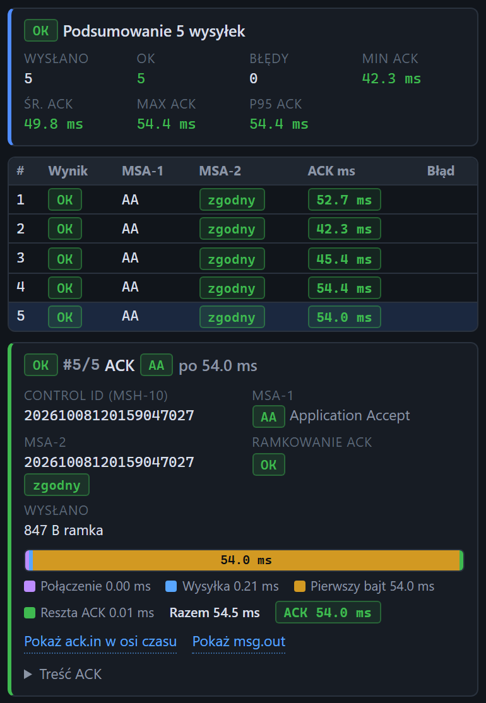

# Wynik serii wysyłek

[Spis treści](README.md) · Poprzednia: [Wynik wysyłki: błąd](24-wynik-wysylki-blad.md) · Następna: [Adres bramki dla scenariuszy](30-adres-bramki.md) <!-- nav -->

Gdy pole **Powtórzenia** ma wartość większą niż 1, tester wysyła serię wiadomości i po zakończeniu
całej serii pokazuje trzy części: podsumowanie, tabelę wysyłek i szczegóły jednej z nich. W trakcie
serii karta pokazuje napis „Wysyłanie do host:port (N razy)...”, a kolejne wysyłki widać na bieżąco
na osi czasu.

## Podsumowanie

Nagłówek ma znaczek **OK**, gdy wszystkie wysyłki się udały, albo **CZĘŚCIOWO**, gdy część się nie
udała. Wtedy pojawia się też żółte powiadomienie z liczbą nieudanych.

| Pole | Znaczenie |
|---|---|
| **Wysłano** | liczba wysyłek w serii |
| **OK** | ile wysyłek zakończyło się bez błędu (z ACK, a przy wyłączonym „Oczekuj ACK” po samym wysłaniu) |
| **Błędy** | ile się nie udało; większe od zera jest czerwone |
| **Min ACK** | najkrótszy czas odpowiedzi bramki |
| **Śr. ACK** | średni czas odpowiedzi |
| **Max ACK** | najdłuższy czas odpowiedzi |
| **P95 ACK** | czas, w którym zmieściło się 95% odpowiedzi; mniej wrażliwy na pojedynczy wyjątek niż maksimum |

Czasy są kolorowane według progów z [Ustawień](04-okno-ustawien.md).

## Tabela wysyłek

| Kolumna | Znaczenie |
|---|---|
| **#** | numer wysyłki w serii |
| **Wynik** | OK albo BŁĄD |
| **MSA-1** | kod z ACK |
| **MSA-2** | **zgodny** albo **niezgodny** z wysłanym MSH-10 |
| **ACK ms** | czas odpowiedzi w kolorze według progów |
| **Błąd** | opis błędu, gdy wysyłka się nie udała |

Kliknięcie wiersza pokazuje pod tabelą pełną kartę tej wysyłki, taką jak [wynik pojedynczej
wysyłki](23-wynik-wysylki.md). Po zakończeniu serii otwarta jest karta pierwszej nieudanej wysyłki,
a gdy wszystkie się udały, karta ostatniej.

## Jak robić test wydajności

- Włącz **Auto MSH-10**, żeby każda wiadomość miała inny control id.
- Włącz **Jedno połączenie (keepAlive)**, jeśli system źródłowy u klienta trzyma stałe połączenie.
  Wyłącz, jeśli łączy się osobno dla każdej wiadomości.
- Ustaw **Odstęp** na rzeczywiste tempo, np. 200 ms dla pięciu wiadomości na sekundę.
- Gdy wolna jest tylko pierwsza wysyłka serii, to zwykle koszt otwarcia sesji po stronie bramki.
- Gotowy test tego typu to scenariusz `08_czas_odpowiedzi_20x`.

---

[Spis treści](README.md) · Poprzednia: [Wynik wysyłki: błąd](24-wynik-wysylki-blad.md) · Następna: [Adres bramki dla scenariuszy](30-adres-bramki.md) <!-- nav -->
