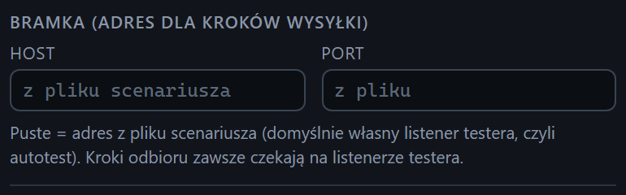

# Adres bramki dla scenariuszy

[Spis treści](README.md) · Poprzednia: [Wynik serii wysyłek](25-wynik-serii.md) · Następna: [Kafelek scenariusza](31-kafelek-scenariusza.md) <!-- nav -->

> Panel **Scenariusze** jest w widokach Standardowy i Pełny. Widok Prosty go ukrywa, patrz [Widok interfejsu](08-widok.md).

Na górze sekcji **Scenariusze** są dwa pola, które mówią, dokąd scenariusze mają wysyłać wiadomości.
Dzięki nim te same pliki scenariuszy działają u każdego klienta bez edycji.

## Pola

| Pole | Znaczenie |
|---|---|
| **Host** | adres bramki, np. `10.20.30.40`. Puste pole: adres z pliku scenariusza |
| **Port** | port bramki, od 1 do 65535. Puste pole: port z pliku scenariusza |

Wartości zapamiętuje przeglądarka. Wpisuje się je raz na początku testów u klienta.

## Co dokładnie nadpisują

- Tylko adres i port **kroków wysyłki**. Pozostałe parametry (ramka, kodowanie, timeouty) pochodzą
  z pliku scenariusza.
- **Kroki odbioru** zawsze czekają na listenerze testera (domyślnie `default`), niezależnie od tych pól.
- Wszystkie dołączone scenariusze mają w pliku adres `127.0.0.1:2575`, czyli własny listener testera.
  Przy pustych polach każdy scenariusz działa więc jako autotest bez bramki. Przydaje się to do
  sprawdzenia, co scenariusz robi, zanim uruchomi się go na prawdziwej bramce.
- Trzy scenariusze zachowują się bez bramki inaczej niż przy niej: `05` kończy się błędem, bo własny
  listener odpowiada AA na wszystko; `06` czeka na wynik, który trzeba odesłać samemu (w panelu
  **Klient** wybierz przykład `oru_r01` i wyślij go w ciągu 5 minut); `07` czeka na dowolną wiadomość,
  np. wysłaną z panelu **Klient**.

## Błędy

Port spoza zakresu 1 do 65535 albo nieliczbowy daje czerwone powiadomienie „Port bramki musi być
liczbą od 1 do 65535”, a scenariusz się nie uruchamia.

Inne parametry, np. kodowanie, można nadpisać tylko w pliku scenariusza albo przez REST API
(`overrides.target`), patrz [docs/SCENARIOS.md](../SCENARIOS.md).

---

[Spis treści](README.md) · Poprzednia: [Wynik serii wysyłek](25-wynik-serii.md) · Następna: [Kafelek scenariusza](31-kafelek-scenariusza.md) <!-- nav -->
