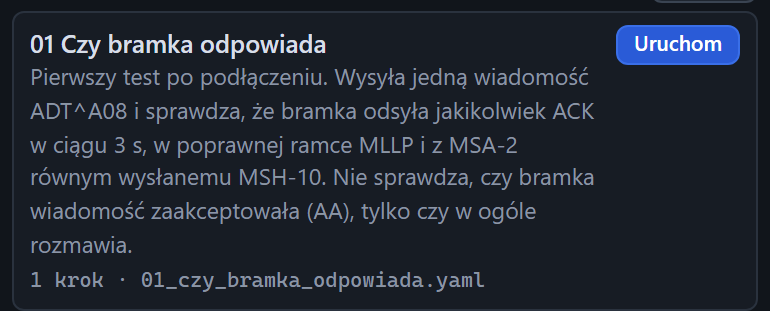

# Kafelek scenariusza

[Spis treści](README.md) · Poprzednia: [Adres bramki dla scenariuszy](30-adres-bramki.md) · Następna: [Scenariusz w trakcie](32-scenariusz-w-trakcie.md) <!-- nav -->

> Panel **Scenariusze** jest w widokach Standardowy i Pełny. Widok Prosty go ukrywa, patrz [Widok interfejsu](08-widok.md).

Lista **Dostępne scenariusze** ma jeden kafelek na każdy plik `.yaml` z katalogu `scenarios/` obok
programu. Scenariusz to zapisany test: seria kroków wysyłki, odbioru i pauzy z warunkami, które muszą
być spełnione.

## Elementy kafelka

| Element | Znaczenie |
|---|---|
| Nazwa (np. **01 Czy bramka odpowiada**) | pole `name` z pliku scenariusza |
| Opis | pole `description` z pliku: co scenariusz sprawdza i jak go użyć |
| `1 krok · 01_czy_bramka_odpowiada.yaml` | liczba kroków i nazwa pliku |
| **Uruchom** | uruchamia scenariusz z adresem bramki z pól nad listą, patrz [Adres bramki](30-adres-bramki.md) |

## Scenariusz z błędem w pliku

Gdy plik YAML ma błąd składni albo nieznany klucz, kafelek pokazuje czerwony komunikat „Błąd YAML: …”
z miejscem błędu, a przycisk **Uruchom** jest nieaktywny. Pozostałe scenariusze działają normalnie.

## Przycisk Odśwież

Przycisk **Odśwież** nad listą wczytuje katalog `scenarios/` od nowa. Użyj go po dodaniu albo zmianie
pliku. Powiadomienie pokaże liczbę wczytanych scenariuszy.

## Dołączone scenariusze

| Scenariusz | Co sprawdza |
|---|---|
| `01_czy_bramka_odpowiada` | jakikolwiek ACK w 3 s, poprawna ramka, MSA-2 równe MSH-10 |
| `02_przyjecie_pacjenta_a01` | ADT^A01 przyjęty (AA) w czasie do 1 s |
| `03_hospitalizacja_a01_a08_a03` | przyjęcie, zmiana danych i wypis jednego pacjenta |
| `04_polskie_znaki_iso8859_2` | wiadomość z polskimi znakami w ISO-8859-2 |
| `05_bledna_wiadomosc` | ADT^A01 bez PID ma dostać AE albo AR |
| `06_zlecenie_i_wynik` | zlecenie ORM^O01 do bramki i wynik ORU^R01 z powrotem na listener testera |
| `07_odbior_z_bramki` | dowolna wiadomość od bramki z poprawną ramką |
| `08_czas_odpowiedzi_20x` | 20 wiadomości na jednym połączeniu, każdy ACK do 500 ms |
| `09_zly_sufiks` | ramka z sufiksem `0D0A` nie powinna dostać ACK |

Co robić, gdy któryś nie przechodzi, i jak napisać własny scenariusz: [docs/SCENARIOS.md](../SCENARIOS.md).

---

[Spis treści](README.md) · Poprzednia: [Adres bramki dla scenariuszy](30-adres-bramki.md) · Następna: [Scenariusz w trakcie](32-scenariusz-w-trakcie.md) <!-- nav -->
