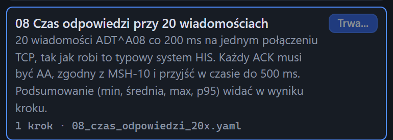

# Scenariusz w trakcie

[Spis treści](README.md) · Poprzednia: [Kafelek scenariusza](31-kafelek-scenariusza.md) · Następna: [Ostatnie uruchomienia](33-ostatnie-uruchomienia.md) <!-- nav -->

Po kliknięciu **Uruchom** kafelek zmienia wygląd: ma podświetloną ramkę, a przycisk ma napis
**Trwa...** i jest nieaktywny. Jednocześnie pojawia się powiadomienie „Uruchamiam scenariusz …”.

## Co dzieje się w tym czasie

- Scenariusz wykonuje program na serwerze, krok po kroku. Każda wysyłka, każdy ACK i każdy krok
  pojawiają się na bieżąco na [osi czasu](40-os-czasu.md).
- Przeglądarka czeka na koniec całego scenariusza i dopiero wtedy pokazuje wynik w liście
  [Ostatnie uruchomienia](33-ostatnie-uruchomienia.md) i w [szczegółach](34-wynik-scenariusza.md).
- Scenariusz z krokiem odbioru może trwać długo: czeka na wiadomość od bramki do czasu z pliku
  (np. `06_zlecenie_i_wynik` do 5 minut, `07_odbior_z_bramki` do 2 minut).

## Na co uważać

- Zamknięcie albo odświeżenie przeglądarki nie zatrzymuje scenariusza. Program wykona go do końca,
  a wynik pojawi się na liście ostatnich uruchomień po ponownym otwarciu strony.
- Można uruchomić inny scenariusz, zanim skończy się pierwszy. Oba będą wtedy wysyłać jednocześnie,
  co utrudnia czytanie osi czasu i może zawyżyć czasy odpowiedzi. Lepiej uruchamiać je po kolei.
- Scenariusza w trakcie nie da się przerwać z interfejsu. Krok czekający na odbiór kończy się po swoim
  timeoucie.

---

[Spis treści](README.md) · Poprzednia: [Kafelek scenariusza](31-kafelek-scenariusza.md) · Następna: [Ostatnie uruchomienia](33-ostatnie-uruchomienia.md) <!-- nav -->
