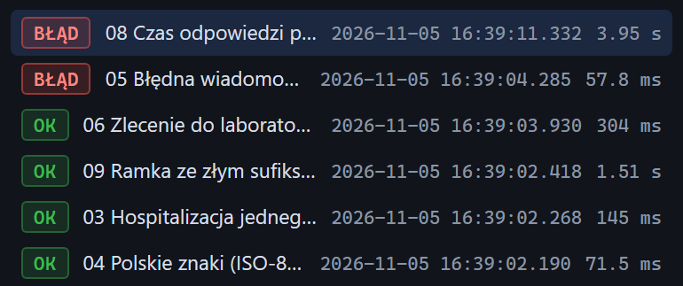

# Ostatnie uruchomienia

[Spis treści](README.md) · Poprzednia: [Scenariusz w trakcie](32-scenariusz-w-trakcie.md) · Następna: [Wynik scenariusza](34-wynik-scenariusza.md) <!-- nav -->

> Panel **Scenariusze** jest w widokach Standardowy i Pełny. Widok Prosty go ukrywa, patrz [Widok interfejsu](08-widok.md).

Lista pod kafelkami scenariuszy pokazuje wykonane przebiegi, od najnowszego.

## Elementy wiersza

| Element | Znaczenie |
|---|---|
| Znaczek statusu | **OK** (zielony): wszystkie kroki spełniły warunki. **BŁĄD** (czerwony): co najmniej jeden warunek niespełniony. **ZATRZYMANY** (żółty): przerwany przyciskiem **Zatrzymaj**. **BŁĄD WYKONANIA** (czerwony): scenariusza nie dało się wykonać, np. brak pliku z wiadomością, nieistniejący listener |
| Nazwa | nazwa scenariusza; długa nazwa jest skracana |
| Data i godzina | początek przebiegu z milisekundami |
| Czas trwania | ile trwał cały przebieg |

Kliknięcie wiersza otwiera pod listą [szczegóły przebiegu](34-wynik-scenariusza.md). Otwarty wiersz
jest podświetlony.

## Zasady listy

- Lista jest wspólna dla wszystkich przeglądarek: widać na niej także przebiegi uruchomione przez
  inne osoby albo przez REST API.
- Widać najwyżej 30 ostatnich przebiegów. Program pamięta 50.
- Lista jest w pamięci programu i znika po jego restarcie. Wyniki do raportu zapisz przyciskiem
  **Kopiuj JSON** w szczegółach albo eksportem zdarzeń.
- Przycisk **Wyczyść** w górnym pasku nie usuwa tej listy.

---

[Spis treści](README.md) · Poprzednia: [Scenariusz w trakcie](32-scenariusz-w-trakcie.md) · Następna: [Wynik scenariusza](34-wynik-scenariusza.md) <!-- nav -->
