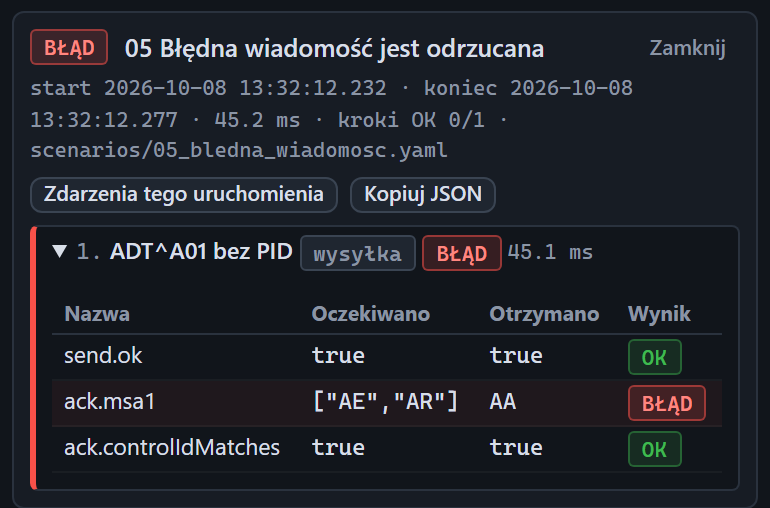

# Wynik scenariusza

[Spis treści](README.md) · Poprzednia: [Ostatnie uruchomienia](33-ostatnie-uruchomienia.md) · Następna: [Oś czasu](40-os-czasu.md) <!-- nav -->

Szczegóły przebiegu otwierają się pod listą ostatnich uruchomień po kliknięciu wiersza i od razu po
zakończeniu scenariusza uruchomionego z tej przeglądarki.

## Nagłówek

| Element | Znaczenie |
|---|---|
| Znaczek statusu i nazwa | wynik całego przebiegu, jak na [liście](33-ostatnie-uruchomienia.md) |
| **Zamknij** | chowa szczegóły |
| Linia z czasami | początek, koniec, czas trwania, liczba udanych kroków (np. „kroki OK 0/1”) i plik scenariusza |
| **Zdarzenia tego uruchomienia** | otwiera pasek filtrów i zawęża oś czasu do zdarzeń tego przebiegu: start, kroki i koniec scenariusza. Wiadomości i ACK są zapisane pod punktami `sender` i listenera, więc ich szukaj po czasie albo linkami przy krokach |
| **Kopiuj JSON** | kopiuje pełny wynik, ze wszystkimi krokami, warunkami i czasami, do schowka; nadaje się jako załącznik do protokołu testów |

## Kroki

Każdy krok to rozwijany wiersz. Kroki nieudane i z błędem są rozwinięte od razu, udane i pominięte
zwinięte.

| Element wiersza | Znaczenie |
|---|---|
| Numer i nazwa | kolejność i pole `name` kroku z pliku |
| Rodzaj | **wysyłka**, **odbiór** albo **pauza** |
| Status | **OK**, **BŁĄD** (warunek niespełniony), **BŁĄD WYKONANIA** (krok nie mógł się wykonać), **ZATRZYMANY** (krok przerwany przyciskiem **Zatrzymaj**), **pominięty** (krok nie był wykonywany, bo wcześniejszy się nie udał) |
| Czas | ile trwał krok |

Po rozwinięciu krok pokazuje komunikat błędu wykonania (jeśli był), tabelę warunków i linki.

## Tabela warunków

| Kolumna | Znaczenie |
|---|---|
| **Nazwa** | który warunek sprawdzono |
| **Oczekiwano** | wartość z pliku scenariusza |
| **Otrzymano** | wartość faktyczna |
| **Wynik** | **OK** albo **BŁĄD**; wiersz z błędem ma czerwone tło |

Najczęstsze nazwy warunków:

| Nazwa | Co sprawdza |
|---|---|
| `send.ok` | wysyłka zakończona bez błędu połączenia i z ACK |
| `send.delivered` | przy teście braku ACK: wiadomość wyszła |
| `ack.received` | ACK przyszedł |
| `ack.timeout` | ACK nie przyszedł, gdy scenariusz tego oczekuje |
| `ack.msa1` | kod MSA-1, np. oczekiwano `AA`, albo listy `["AE","AR"]` |
| `ack.controlIdMatches` | MSA-2 równe wysłanemu MSH-10 |
| `ack.maxAckMs` | czas ACK nie większy niż podany, np. `<= 1000 ms` |
| `framing.prefixOk`, `framing.suffixOk`, `framing.segmentSeparator`, `framing.trailingSeparator` | ramka ACK (krok wysyłki) albo odebranej wiadomości (krok odbioru) |
| `fields.PID-3.1` | wartość pola pod podaną ścieżką |
| `receive.message` | w kroku odbioru: wiadomość przyszła w czasie |
| `receive.maxReceiveMs` | czas odbioru ramki nie większy niż podany |

Przy serii wysyłek w jednym kroku nazwy dostają numer wysyłki, np. `#3 ack.maxAckMs`.

## Linki przy kroku

| Link | Działanie |
|---|---|
| **Pokaż ACK / wynik wysyłki** | otwiera w inspektorze ACK tego kroku, a gdy go nie było, brak ACK albo błąd |
| **Pokaż msg.out** | otwiera wysłaną wiadomość |
| **Pokaż odebraną wiadomość #N** | w kroku odbioru: otwiera wiadomość, która spełniła warunek |

## Jak czytać wynik ze zrzutu

Scenariusz `05_bledna_wiadomosc` oczekiwał, że bramka odrzuci wiadomość bez PID (`AE` albo `AR`).
Odpowiedziała `AA`, więc warunek `ack.msa1` ma **BŁĄD**. Wysyłka i zgodność MSA-2 są poprawne. Wniosek:
bramka nie waliduje obecności segmentu PID.

---

[Spis treści](README.md) · Poprzednia: [Ostatnie uruchomienia](33-ostatnie-uruchomienia.md) · Następna: [Oś czasu](40-os-czasu.md) <!-- nav -->
