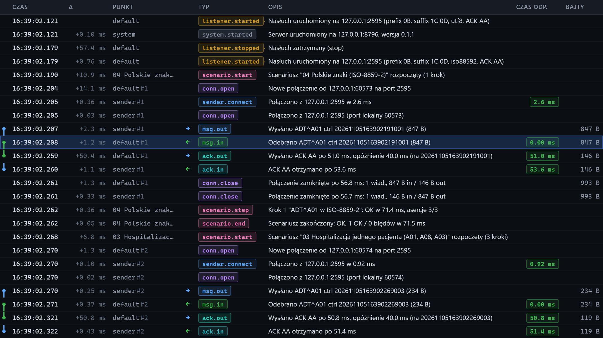

# Oś czasu

[Spis treści](README.md) · Poprzednia: [Wynik scenariusza](34-wynik-scenariusza.md) · Następna: [Pasek filtrów](41-pasek-filtrow.md) <!-- nav -->

> Widoki Prosty i Standardowy ukrywają kolumny **Δ** i **Bajty** oraz zdarzenia `conn.open`, `conn.close` i `sender.connect`, a Prosty także kolumnę **Punkt**, patrz [Widok interfejsu](08-widok.md).

Środek ekranu to tabela wszystkich zdarzeń, od najstarszego na górze do najnowszego na dole. Nowe
zdarzenia dopisują się na bieżąco, a widok sam przewija się w dół (autoprzewijanie, patrz
[Wstrzymane przewijanie](43-wstrzymane-przewijanie.md)). Kliknięcie wiersza otwiera zdarzenie
w inspektorze; zaznaczony wiersz ma niebieskie tło.

## Kolumny

| Kolumna | Znaczenie |
|---|---|
| (pasek po lewej) | łańcuch wiadomość i jej ACK, opis niżej |
| **Czas** | godzina zdarzenia z milisekundami. Po najechaniu: pełny czas ISO w UTC i numer zdarzenia |
| **Δ** | odstęp od poprzedniego widocznego wiersza, z zegara monotonicznego. Ukryte filtrem wiersze się nie liczą |
| **Punkt** | kto wygenerował zdarzenie i na którym połączeniu: identyfikator listenera (np. `default`), `sender` dla klienta, identyfikator przebiegu scenariusza, `system`. Dopisek `#1`, `#2` to numer połączenia TCP; to samo połączenie ma ten sam numer we wszystkich swoich zdarzeniach |
| (strzałka) | `←` zielona: dane przychodzące do testera; `→` niebieska: dane wychodzące |
| **Typ** | rodzaj zdarzenia w kolorowym znaczku, np. `msg.in`. Po najechaniu: polska nazwa. Pełna lista: [Filtr typów](42-filtr-typow.md) |
| **Opis** | co się stało, po polsku. Żółty tekst: ostrzeżenie (np. zła ramka). Czerwony: błąd (np. brak ACK) |
| **Czas odp.** | główny czas zdarzenia w kolorze według progów z [Ustawień](04-okno-ustawien.md); dla braku ACK czerwony znaczek `timeout` |
| **Bajty** | rozmiar danych: ramki, fragmentu albo połączenia |

Wiersze z ostrzeżeniem mają też żółty, a z błędem czerwony pasek przy lewej krawędzi.

## Co znaczy czas w kolumnie Czas odp.

| Typ zdarzenia | Czas |
|---|---|
| `ack.in` (ACK odebrany) | czas odpowiedzi bramki: od wysłania wiadomości do kompletnego ACK |
| `ack.out` (ACK wysłany) | czas odpowiedzi testera: od kompletnej wiadomości do wysłania ACK, z celowym opóźnieniem |
| `msg.in` (wiadomość odebrana) | czas odbioru: od pierwszego do ostatniego bajtu ramki; 0 oznacza ramkę w jednym pakiecie |
| `sender.connect` | czas nawiązania połączenia TCP z bramką |

## Łańcuchy wiadomość i ACK

Pionowa linia przy lewej krawędzi łączy wiadomość z jej odpowiedzią:

| Kolor | Łańcuch |
|---|---|
| zielony | wiadomość odebrana przez serwer (`msg.in`) i ACK, który serwer odesłał (`ack.out`) |
| niebieski | wiadomość wysłana przez klienta (`msg.out`) i ACK od bramki (`ack.in`) |
| czerwony | brak ACK (`ack.timeout`), ACK z odrzuceniem (MSA-1 inne niż AA i CA) albo ACK pominięty (tryb `none`) |

Gdy między wiadomością a ACK jest wiele innych wierszy, linia jest blada. Program łączy pary po
control id i numerze połączenia.

## Pojemność

Przeglądarka trzyma najwyżej 2000 zdarzeń; starsze usuwa z osi czasu. Program trzyma ostatnie 5000,
a plik `logs/events.ndjson` wszystkie. Linki do usuniętych zdarzeń (np. z wyniku scenariusza) nadal
działają: przeglądarka pobiera je z programu i pokazuje w inspektorze.

Pusta oś czasu pokazuje napis „Brak zdarzeń. Oczekiwanie na ruch MLLP...”.

## Nawigacja klawiaturą

`↓` i `↑` zaznaczają następne i poprzednie zdarzenie, `PageDown` i `PageUp` przeskakują o 20,
`End` wraca do najnowszego, `Esc` odznacza. Pełna lista: [Ekran główny](01-ekran-glowny.md).

---

[Spis treści](README.md) · Poprzednia: [Wynik scenariusza](34-wynik-scenariusza.md) · Następna: [Pasek filtrów](41-pasek-filtrow.md) <!-- nav -->
