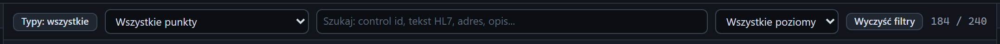

# Pasek filtrów

[Spis treści](README.md) · Poprzednia: [Oś czasu](40-os-czasu.md) · Następna: [Filtr typów zdarzeń](42-filtr-typow.md) <!-- nav -->

> Filtry są w widokach Standardowy i Pełny. Widok Prosty je ukrywa i czyści, patrz [Widok interfejsu](08-widok.md).

Pasek nad osią czasu zawęża to, co widać. Otwiera go przycisk **Filtry** w górnym pasku albo
klawisz `/`. Przeglądarka pamięta, czy pasek był otwarty. Wszystkie filtry działają naraz: wiersz
jest widoczny, gdy spełnia każdy z nich.

## Elementy

| Element | Działanie |
|---|---|
| **Typy: wszystkie** | rozwija [listę typów zdarzeń](42-filtr-typow.md) z polami wyboru. Po zawężeniu napis zmienia się na „Typy: 6 z 24” |
| **Wszystkie punkty** | pokazuje tylko zdarzenia jednego punktu: listenera, klienta (`sender`), przebiegu scenariusza albo `system`. Lista zawiera punkty, które pojawiły się na osi czasu |
| **Szukaj** | pokazuje zdarzenia, które zawierają wpisany tekst, bez rozróżniania wielkości liter. `Esc` w polu czyści tekst |
| **Wszystkie poziomy** | **Info**, **Ostrzeżenia** albo **Błędy** |
| **Wyczyść filtry** | przywraca wszystkie filtry do stanu początkowego |
| Licznik `182 / 278` | widoczne wiersze / zdarzenia w pamięci przeglądarki |

Aktywny filtr ma podświetloną ramkę.

## Co przeszukuje pole Szukaj

Typ, punkt, numer połączenia, opis polski i angielski, poziom, numer zdarzenia (`#123`), control id
wiadomości i ACK, pierwsze 4 KB treści HL7, komunikaty błędów, nazwy, kody oraz adresy w postaci
`host:port`. Przykłady:

| Wpisz | Zobaczysz |
|---|---|
| control id, np. `20261008110552446001` | wiadomość, jej ACK i powiązane zdarzenia |
| numer PESEL albo nazwisko | wiadomości z tym pacjentem |
| `ADT^A08` | wiadomości tego typu |
| `10.20.30.40` | połączenia z tym adresem |
| `default#5` | wszystkie zdarzenia piątego połączenia listenera `default` |

## Inne sposoby ustawienia filtra

- **Zdarzenia** na kafelku serwera ustawia punkt na ten listener.
- **Zdarzenia tego uruchomienia** w wyniku scenariusza ustawia punkt na ten przebieg.

## Wpływ na inne funkcje

- [Eksport](03-menu-eksport.md) uwzględnia aktywne filtry.
- Odstęp w kolumnie **Δ** liczy się między widocznymi wierszami.
- Link do zdarzenia ukrytego filtrem otwiera je w inspektorze z powiadomieniem „Zdarzenie #N jest
  ukryte przez filtry”.
- Zdarzenia bajtów (`bytes.in`, `bytes.out`) są ukryte niezależnie od filtra, dopóki nie włączy się
  ich w [Ustawieniach](04-okno-ustawien.md).

---

[Spis treści](README.md) · Poprzednia: [Oś czasu](40-os-czasu.md) · Następna: [Filtr typów zdarzeń](42-filtr-typow.md) <!-- nav -->
