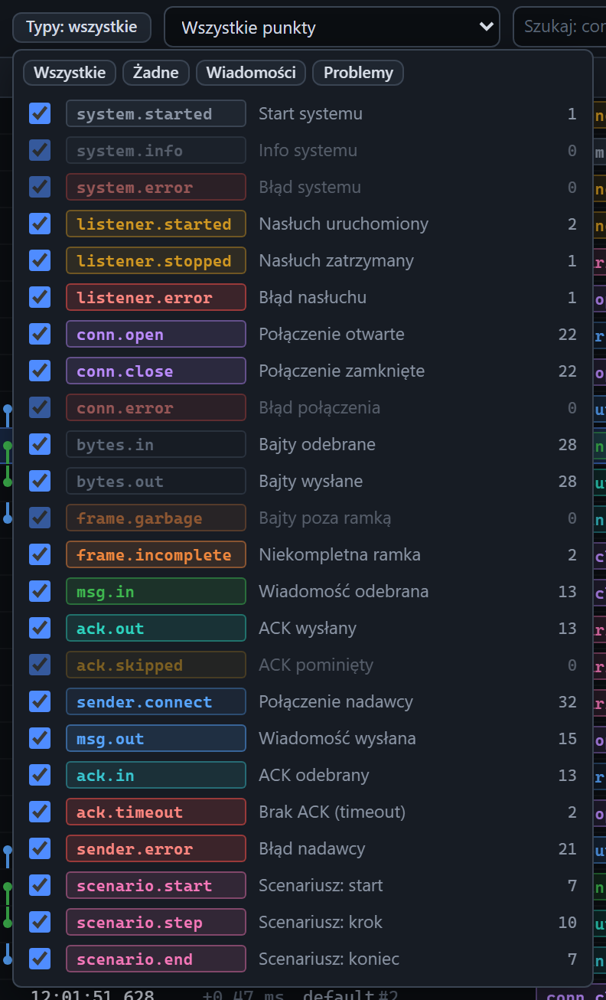

# Filtr typów zdarzeń

[Spis treści](README.md) · Poprzednia: [Pasek filtrów](41-pasek-filtrow.md) · Następna: [Wstrzymane przewijanie](43-wstrzymane-przewijanie.md) <!-- nav -->

Przycisk **Typy** w pasku filtrów rozwija listę wszystkich typów zdarzeń. Odznaczony typ znika z osi
czasu. Lista zamyka się po kliknięciu poza nią albo klawiszem `Esc`.

## Elementy listy

| Element | Działanie |
|---|---|
| **Wszystkie** | zaznacza wszystkie typy |
| **Żadne** | odznacza wszystkie; potem można zaznaczyć tylko potrzebne |
| **Wiadomości** | tylko wiadomości i ACK: `msg.in`, `ack.out`, `msg.out`, `ack.in`, `ack.timeout`, `ack.skipped` |
| **Problemy** | tylko problemy z ramką i połączeniami: `frame.garbage`, `frame.incomplete`, `conn.error`, `listener.error`, `sender.error`, `ack.timeout`, `system.error` |
| Wiersz typu | pole wyboru, znaczek w kolorze typu, polska nazwa i liczba takich zdarzeń w przeglądarce. Typy bez zdarzeń są wyszarzone |

## Typy zdarzeń

| Typ | Nazwa | Kiedy powstaje |
|---|---|---|
| `system.started` | Start systemu | program wystartował |
| `system.info`, `system.error` | Info / Błąd systemu | komunikat albo nieoczekiwany błąd programu |
| `listener.started` | Nasłuch uruchomiony | listener otworzył port |
| `listener.stopped` | Nasłuch zatrzymany | listener zamknął port (Stop, zmiana konfiguracji, wyłączenie programu) |
| `listener.error` | Błąd nasłuchu | listener nie mógł otworzyć portu |
| `conn.open` | Połączenie otwarte | bramka połączyła się z listenerem albo klient z bramką |
| `conn.close` | Połączenie zamknięte | koniec połączenia: czas trwania, bajty, liczba wiadomości |
| `conn.error` | Błąd połączenia | błąd gniazda TCP, np. zerwanie połączenia, ramka ponad limit |
| `bytes.in`, `bytes.out` | Bajty odebrane / wysłane | każdy fragment TCP; widoczne po włączeniu w Ustawieniach |
| `frame.garbage` | Bajty poza ramką | bramka przysłała bajty, gdy klient nie czekał na odpowiedź |
| `frame.incomplete` | Niekompletna ramka | bajty bez sufiksu po timeoucie ramki, bezczynności albo zamknięciu połączenia |
| `msg.in` | Wiadomość odebrana | listener odebrał kompletną ramkę |
| `ack.out` | ACK wysłany | listener odesłał ACK |
| `ack.skipped` | ACK pominięty | listener w trybie `none` nie odesłał ACK |
| `sender.connect` | Połączenie nadawcy | wynik łączenia klienta z bramką, z czasem |
| `msg.out` | Wiadomość wysłana | klient wysłał wiadomość |
| `ack.in` | ACK odebrany | klient dostał ACK od bramki, z walidacją i czasami |
| `ack.timeout` | Brak ACK (timeout) | ACK nie przyszedł w czasie |
| `sender.error` | Błąd nadawcy | błąd klienta w fazie łączenia, wysyłki albo oczekiwania |
| `scenario.start`, `scenario.step`, `scenario.end` | Scenariusz: start / krok / koniec | przebieg scenariusza |

Szczegóły każdego typu w inspektorze opisują strony w grupie [Inspektor](README.md#inspektor).

---

[Spis treści](README.md) · Poprzednia: [Pasek filtrów](41-pasek-filtrow.md) · Następna: [Wstrzymane przewijanie](43-wstrzymane-przewijanie.md) <!-- nav -->
