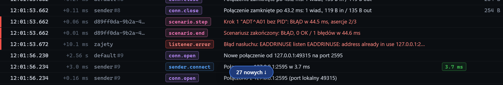

# Wstrzymane przewijanie

[Spis treści](README.md) · Poprzednia: [Filtr typów zdarzeń](42-filtr-typow.md) · Następna: [Podświetlanie powiązanych zdarzeń](44-powiazane-zdarzenia.md) <!-- nav -->

Oś czasu sama przewija się do najnowszego zdarzenia. Przy dużym ruchu utrudnia to czytanie, więc
przewijanie można wstrzymać.

## Jak wstrzymać

- Przycisk **⏸ Autoprzewijanie** w górnym pasku albo klawisz `Spacja`.
- Przewinięcie osi czasu w górę kółkiem myszy albo paskiem przewijania. Przewijanie wstrzymuje się
  samo i wraca samo, gdy przewiniesz z powrotem na sam dół.

## Co widać po wstrzymaniu

| Element | Znaczenie |
|---|---|
| Przycisk **N nowych ↓** na dole osi czasu | ile zdarzeń przyszło od wstrzymania. Kliknięcie wznawia przewijanie i przenosi na koniec |
| Przycisk **▶ Wznów (N)** w górnym pasku | to samo; kliknięcie albo klawisz `End` wznawia |

Nowe zdarzenia nadal dopisują się na dole, ale widok stoi w miejscu. Gdy przeglądarka usuwa
najstarsze zdarzenia (limit 2000), widok koryguje się tak, żeby czytany fragment nie uciekał.

## Kiedy wstrzymywać

- Gdy trzeba przeczytać zdarzenia sprzed chwili, a bramka dalej wysyła.
- Podczas porównywania wiadomości z logiem bramki.
- Przed kliknięciem wiersza przy szybkim ruchu, żeby trafić we właściwy wiersz.

---

[Spis treści](README.md) · Poprzednia: [Filtr typów zdarzeń](42-filtr-typow.md) · Następna: [Podświetlanie powiązanych zdarzeń](44-powiazane-zdarzenia.md) <!-- nav -->
