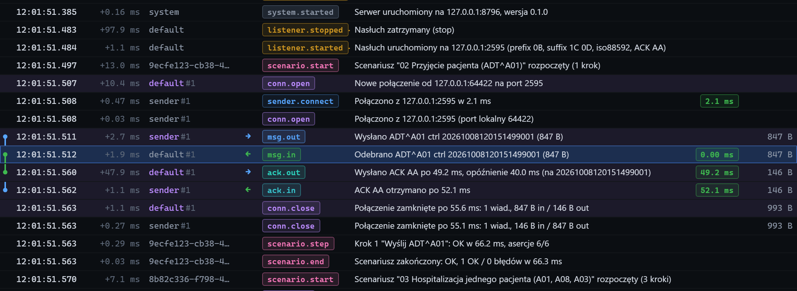

# Podświetlanie powiązanych zdarzeń

[Spis treści](README.md) · Poprzednia: [Wstrzymane przewijanie](43-wstrzymane-przewijanie.md) · Następna: [Wiadomość odebrana](50-wiadomosc-odebrana.md) <!-- nav -->

Po najechaniu kursorem na wiersz osi czasu program podświetla wszystkie zdarzenia z nim powiązane:
jasnofioletowym tłem i fioletową nazwą w kolumnie **Punkt**. Sam wiersz pod kursorem jest
zaznaczony jaśniej.

## Co jest powiązane

| Powiązanie | Przykład |
|---|---|
| to samo połączenie TCP | otwarcie połączenia, fragmenty danych, wiadomość, ACK i zamknięcie z punktem `default#1` |
| ten sam control id | wiadomość wysłana przez klienta (`msg.out`), ta sama wiadomość odebrana przez listener (`msg.in`), ACK listenera (`ack.out`) i ACK odebrany przez klienta (`ack.in`) |
| para wiadomość i ACK | ACK powiązany z wiadomością łańcuchem, także gdy nie mają wspólnego połączenia |

Na zrzucie kursor stoi na wiadomości odebranej przez listener. Podświetlone są zdarzenia jej
połączenia `default#1` oraz zdarzenia klienta `sender#1`, które mają ten sam control id.

## Do czego to służy

- **Pętla przez bramkę:** wiadomość wysłana do bramki i ta sama wiadomość (po control id) odebrana
  przez listener po przejściu przez bramkę.
- **Jedno połączenie wśród wielu:** gdy bramka otwiera kilka połączeń naraz, widać, które zdarzenia
  należą do którego.
- **Szybkie sprawdzenie odpowiedzi:** czy dana wiadomość dostała ACK i ile to trwało.

Podświetlenie obejmuje najwyżej 500 wierszy i znika, gdy kursor opuści tabelę. Do trwałego zawężenia
widoku służy pole **Szukaj** w [pasku filtrów](41-pasek-filtrow.md), np. z control id albo numerem
połączenia.

---

[Spis treści](README.md) · Poprzednia: [Wstrzymane przewijanie](43-wstrzymane-przewijanie.md) · Następna: [Wiadomość odebrana](50-wiadomosc-odebrana.md) <!-- nav -->
