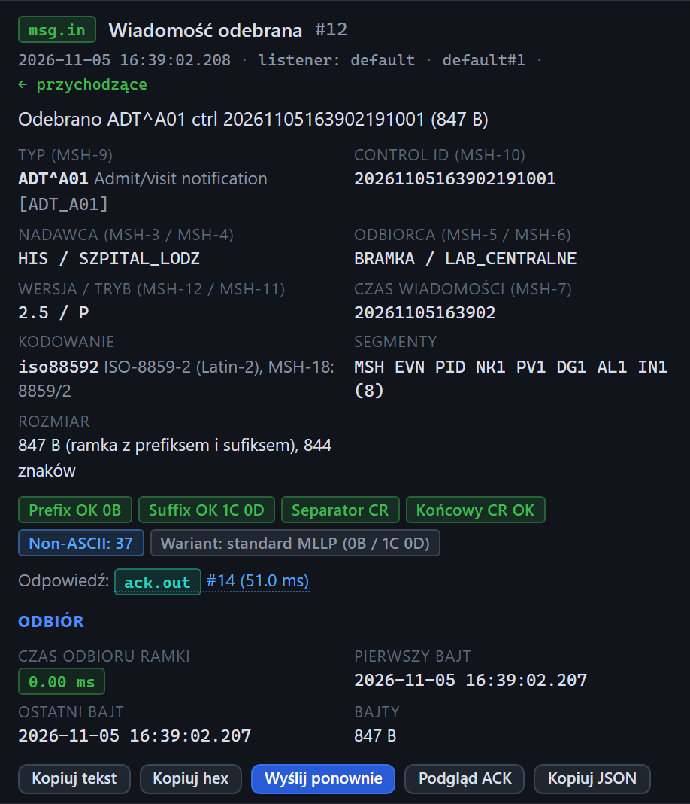

# Inspektor: wiadomość odebrana

[Spis treści](README.md) · Poprzednia: [Podświetlanie powiązanych zdarzeń](44-powiazane-zdarzenia.md) · Następna: [Znaczki ramki](51-znaczki-ramki.md) <!-- nav -->

> Widoki Prosty i Standardowy ukrywają dodatkowe pola (wersja, czas MSH-7, kodowanie, segmenty, rozmiar) i sekcję **Odbiór**, a Prosty także znaczki ramki, patrz [Widok interfejsu](08-widok.md).

Inspektor to panel po prawej stronie ekranu. Pokazuje szczegóły zdarzenia zaznaczonego na osi czasu.
Ta strona opisuje górną część inspektora dla wiadomości, którą listener testera odebrał od bramki
(typ `msg.in`). Pod nią są zakładki z treścią: [Czytelny](52-zakladka-czytelny.md),
[Drzewo](53-zakladka-drzewo.md) i [Hex](54-zakladka-hex.md).

## Tytuł i metadane

| Element | Znaczenie |
|---|---|
| Znaczek typu i nazwa | `msg.in` **Wiadomość odebrana** |
| `#12` | numer zdarzenia; ten sam numer jest w eksporcie |
| **Ostrzeżenie** albo **Błąd** | poziom zdarzenia, widoczny tylko, gdy nie jest zwykłą informacją (np. zła ramka albo niezgodne kodowanie) |
| Data i czas z milisekundami | kiedy wiadomość była kompletna. Po najechaniu: czas ISO w UTC i odczyt zegara monotonicznego |
| `listener: default` | który listener odebrał wiadomość |
| `default#1` | numer połączenia TCP |
| `← przychodzące` | kierunek danych |
| Opis | to samo zdanie co w kolumnie Opis osi czasu |

## Dane z nagłówka wiadomości

| Pole | Skąd | Znaczenie |
|---|---|---|
| **Typ (MSH-9)** | MSH-9 | typ i zdarzenie, np. `ADT^A01`, z opisem (Admit/visit notification) i strukturą w nawiasie |
| **Control ID (MSH-10)** | MSH-10 | identyfikator wiadomości; ACK powinien go powtórzyć w MSA-2 |
| **Nadawca (MSH-3 / MSH-4)** | MSH-3, MSH-4 | aplikacja i placówka nadawcy |
| **Odbiorca (MSH-5 / MSH-6)** | MSH-5, MSH-6 | aplikacja i placówka odbiorcy |
| **Wersja / tryb (MSH-12 / MSH-11)** | MSH-12, MSH-11 | wersja HL7 (np. 2.5) i tryb: `P` produkcja, `T` test, `D` debug |
| **Czas wiadomości (MSH-7)** | MSH-7 | czas utworzenia wiadomości po stronie nadawcy |
| **Kodowanie** | konfiguracja listenera i MSH-18 | kodowanie, którym listener odczytał bajty, oraz wartość MSH-18 zadeklarowana w wiadomości |
| **Segmenty** | treść | lista segmentów i ich liczba |
| **Rozmiar** | ramka | rozmiar ramki w bajtach (z prefiksem i sufiksem) oraz długość tekstu w znakach |

Gdy wiadomości nie da się odczytać jako HL7, w miejscu tych pól jest czerwony komunikat
„Parsowanie: nie powiodło się” z powodem.

## Ramka i ostrzeżenia

Pod danymi są [znaczki ramki](51-znaczki-ramki.md): prefiks, sufiks, separator segmentów, CR na końcu,
liczba bajtów spoza ASCII i rozpoznany wariant ramki. Pod znaczkami, jeśli coś jest nie tak, lista
ostrzeżeń, np. „Sufiks niezgodny”, „Segmenty rozdzielone LF zamiast CR”, „MSH-18 deklaruje 8859/2,
a treść zdekodowano jako cp1250”.

## Odpowiedź

Linia **Odpowiedź:** ze znaczkiem `ack.out` i numerem prowadzi do ACK, który listener odesłał.
W nawiasie czas przetwarzania. Kliknięcie otwiera ten ACK, patrz
[ACK wysłany](55-ack-wyslany.md). Gdy listener nie odpowiedział (tryb `none` albo błąd), jest tu
napis „Brak powiązanego ACK wychodzącego”.

## Odbiór

| Pole | Znaczenie |
|---|---|
| **Czas odbioru ramki** | od pierwszego do ostatniego bajtu ramki. 0 oznacza, że cała ramka przyszła w jednym pakiecie TCP; duża wartość oznacza ramkę dzieloną na pakiety albo wolne łącze |
| **Pierwszy bajt** / **Ostatni bajt** | czasy przyjścia pierwszego i ostatniego bajtu ramki, do porównania z logiem bramki |
| **Bajty** | rozmiar ramki |

## Przyciski

| Przycisk | Działanie |
|---|---|
| **Kopiuj tekst** | kopiuje treść HL7 do schowka, z separatorami segmentów takimi, jakie przyszły |
| **Kopiuj hex** | kopiuje bajty całej ramki jako hex, z prefiksem i sufiksem |
| **Wyślij ponownie** | wkłada treść do edytora w sekcji Klient i przewija do niej. Adres w formularzu klienta się nie zmienia |
| **Podgląd ACK** | otwiera [okno Podgląd ACK](62-podglad-ack.md) dla tej wiadomości |
| **Kopiuj JSON** | kopiuje całe zdarzenie w formacie JSON, np. do zgłoszenia problemu |

---

[Spis treści](README.md) · Poprzednia: [Podświetlanie powiązanych zdarzeń](44-powiazane-zdarzenia.md) · Następna: [Znaczki ramki](51-znaczki-ramki.md) <!-- nav -->
