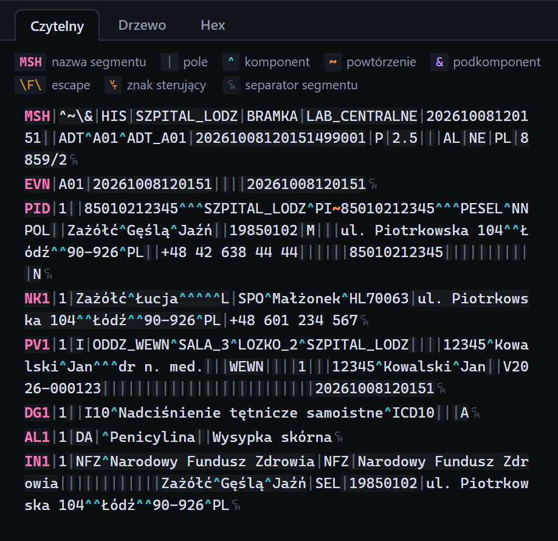

# Zakładka Czytelny

[Spis treści](README.md) · Poprzednia: [Znaczki ramki](51-znaczki-ramki.md) · Następna: [Zakładka Drzewo](53-zakladka-drzewo.md) <!-- nav -->

Pierwsza zakładka pod nagłówkiem inspektora. Pokazuje treść wiadomości tak, żeby dało się ją czytać
okiem: każdy segment w osobnej linii, separatory i części pól w kolorach. Zakładka jest dostępna dla
zdarzeń z treścią HL7 (wiadomości, ACK, niekompletne ramki).

## Legenda

| Kolor albo znak | Znaczenie |
|---|---|
| **MSH** (różowy, pogrubiony) | nazwa segmentu |
| `\|` | separator pola |
| `^` (turkusowy) | separator komponentu |
| `~` (pomarańczowy) | separator powtórzenia |
| `&` (fioletowy) | separator podkomponentu |
| `\F\` | sekwencja escape |
| symbol na pomarańczowym tle | znak sterujący wewnątrz treści, np. `␋` (VT) albo `␜` (FS) |
| symbol na końcu linii | separator segmentu: szary `␍` dla CR, żółty dla LF i CRLF, czerwony przekreślony, gdy na końcu wiadomości brakuje CR |

Kolejne pola segmentu mają na przemian nieco inne tło, co ułatwia liczenie pól.

## Podpowiedzi po najechaniu kursorem

| Na czym | Co pokazuje |
|---|---|
| nazwa segmentu | pełna nazwa, np. `PID: Patient Identification` |
| wartość pola | numer i nazwę pola ze słownika HL7 2.5, np. `PID-3 Patient Identifier List` |
| sekwencja escape | co oznacza: `\F\` separator pola, `\S\` komponentu, `\T\` podkomponentu, `\R\` powtórzenia, `\E\` znak escape, `\Xhh\` bajty w hex, `\.br\` nowa linia |
| znak sterujący | jego nazwę, np. VT, FS |
| symbol końca segmentu | jaki to separator; CR jest zgodny z HL7, LF i CRLF nie |

## Co widać na pierwszy rzut oka

- **Polskie znaki:** jeśli zamiast `ąęłńóśźż` widać inne znaki albo `�`, kodowanie listenera albo
  klienta nie pasuje do bajtów. Szczegóły: [Znaczki ramki](51-znaczki-ramki.md), [Hex](54-zakladka-hex.md).
- **Złe separatory segmentów:** żółty symbol końca linii.
- **Brak CR na końcu:** czerwony przekreślony symbol na końcu ostatniej linii.
- **Znaki sterujące w treści:** pomarańczowe symbole w środku linii, np. `␋` (VT, prefiks MLLP) albo `␜` (FS).

Zakładka pokazuje najwyżej 300 000 znaków. Dłuższe wiadomości są ucięte z informacją o tym na dole.

---

[Spis treści](README.md) · Poprzednia: [Znaczki ramki](51-znaczki-ramki.md) · Następna: [Zakładka Drzewo](53-zakladka-drzewo.md) <!-- nav -->
