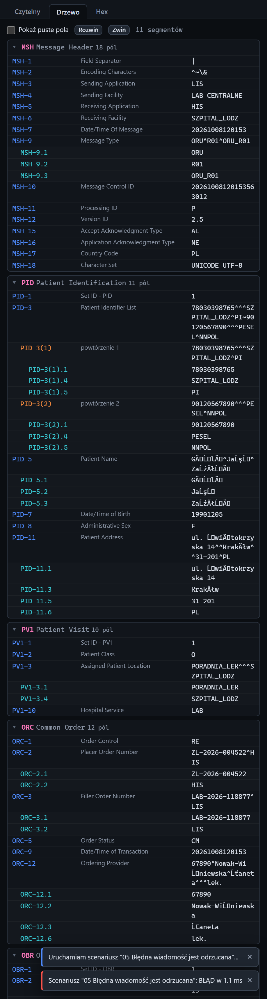

# Zakładka Drzewo

[Spis treści](README.md) · Poprzednia: [Zakładka Czytelny](52-zakladka-czytelny.md) · Następna: [Zakładka Hex](54-zakladka-hex.md) <!-- nav -->

Druga zakładka inspektora rozkłada wiadomość na części: segmenty, pola, powtórzenia, komponenty
i podkomponenty, każdą ze ścieżką i nazwą ze słownika HL7.

## Pasek narzędzi

| Element | Działanie |
|---|---|
| **Pokaż puste pola** | domyślnie puste pola są ukryte; zaznaczenie pokazuje wszystkie, co pomaga liczyć pozycje |
| **Rozwiń** / **Zwiń** | rozwija albo zwija wszystkie segmenty |
| `N segmentów` | liczba segmentów wiadomości |

Pod paskiem mogą być ostrzeżenia z odczytu wiadomości, np. „Pierwszy segment to PID, oczekiwano MSH”
albo „Linia 4 nie zaczyna się od nazwy segmentu”.

## Segmenty

Każdy segment to rozwijany blok z nazwą (np. **MSH**), pełną nazwą (Message Header) i liczbą pól.
Gdy segment występuje kilka razy, nazwa ma numer wystąpienia, np. `OBX[1]`, `OBX[2]`.

## Wiersze

| Kolumna | Znaczenie |
|---|---|
| Ścieżka | położenie wartości, np. `PID-3` (pole), `PID-3(2)` (drugie powtórzenie pola), `PID-3.1` (komponent), `PID-3.1.2` (podkomponent), `OBX[2]-5` (pole drugiego segmentu OBX) |
| Nazwa | nazwa pola ze słownika HL7 2.5, po angielsku, np. Patient Identifier List. Komponenty nie mają nazw |
| Wartość | wartość; znaki sterujące jako symbole, bardzo długie wartości w całości po najechaniu |

## Ścieżki a scenariusze

Ścieżki z tej zakładki można wpisać wprost do plików scenariuszy: w sekcji `fields` (sprawdzenie
wartości) i `match` (wybór wiadomości). Przykład: wartość `ZL-2026-004522` w wierszu `OBR-2.1`
sprawdza w scenariuszu wpis `"OBR-2.1": "ZL-2026-004522"`. Składnia:
[docs/SCENARIOS.md](../SCENARIOS.md).

---

[Spis treści](README.md) · Poprzednia: [Zakładka Czytelny](52-zakladka-czytelny.md) · Następna: [Zakładka Hex](54-zakladka-hex.md) <!-- nav -->
