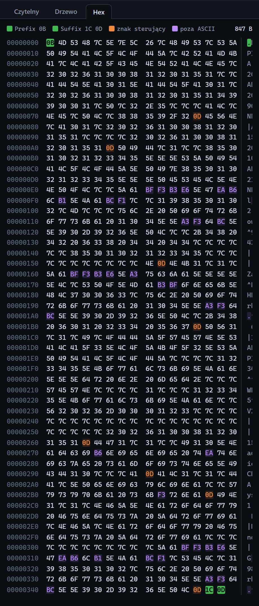

# Zakładka Hex

[Spis treści](README.md) · Poprzednia: [Zakładka Drzewo](53-zakladka-drzewo.md) · Następna: [ACK wysłany przez serwer](55-ack-wyslany.md) <!-- nav -->

Trzecia zakładka inspektora pokazuje surowe bajty, tak jak przyszły albo wyszły przez sieć: całą
ramkę razem z prefiksem i sufiksem. Rozstrzyga spory, które w tekście nie są widoczne: jaki dokładnie
jest sufiks, czy segmenty kończą się CR czy LF, w jakim kodowaniu są polskie znaki.

## Legenda

| Element | Znaczenie |
|---|---|
| **Prefix 0B** (zielony kwadrat) | bajty prefiksu; czerwony, gdy prefiks jest inny niż oczekiwany, z opisem „Prefix: oczekiwano …, otrzymano …” |
| **Suffix 1C 0D** (zielony kwadrat) | bajty sufiksu; czerwony przy niezgodności |
| **znak sterujący** (pomarańczowy) | bajty 0x00 do 0x1F i 0x7F, np. CR (`0D`), LF (`0A`) |
| **poza ASCII** (fioletowy) | bajty 0x80 i wyższe, zwykle polskie znaki |
| `847 B` | rozmiar ramki |

## Kolumny

| Kolumna | Znaczenie |
|---|---|
| Przesunięcie | pozycja pierwszego bajtu w wierszu, szesnastkowo (`00000000`, `00000010`, …) |
| Bajty | 16 bajtów w hex, z odstępem po ośmiu |
| ASCII | te same bajty jako znaki; znaki niedrukowalne jako kropka |

Po najechaniu na bajt widać jego pozycję dziesiętnie i szesnastkowo oraz wartość albo nazwę znaku
sterującego.

## Jak czytać typowe sytuacje

| Co widać | Znaczenie |
|---|---|
| `0B` na początku, `1C 0D` na końcu, oba zielone | ramka MLLP poprawna |
| `0D 0A` na końcu, czerwony sufiks | bramka kończy ramkę CRLF zamiast FS CR |
| `0A` między segmentami zamiast `0D` | separatory LF |
| `C5 BC` w miejscu litery ż | treść w UTF-8 |
| `BF` w miejscu litery ż | treść w CP1250 albo ISO-8859-2 (w obu ż ma kod `BF`); rozróżniają je np. `ą` (`B9` w CP1250, `B1` w ISO-8859-2) i `ś` (`9C` i `B6`) |

Zakładka pokazuje najwyżej pierwsze 64 KB ramki. Dla zdarzeń bajtów (`bytes.in`, `bytes.out`) widać
tylko pierwsze 32 bajty fragmentu; pełne dane są w zdarzeniu wiadomości.

---

[Spis treści](README.md) · Poprzednia: [Zakładka Drzewo](53-zakladka-drzewo.md) · Następna: [ACK wysłany przez serwer](55-ack-wyslany.md) <!-- nav -->
