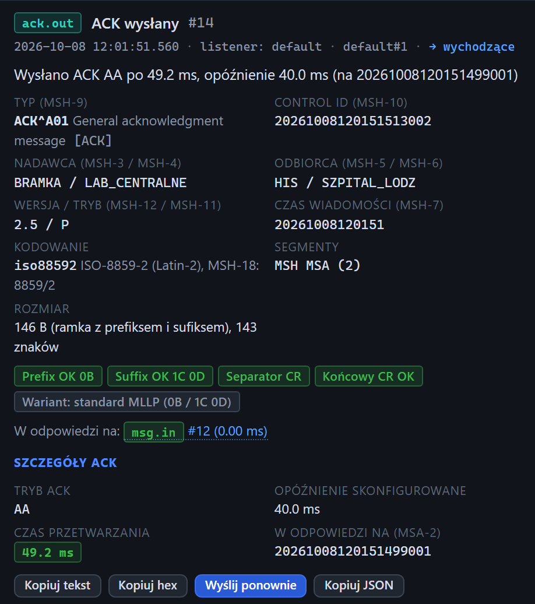

# Inspektor: ACK wysłany przez serwer

[Spis treści](README.md) · Poprzednia: [Zakładka Hex](54-zakladka-hex.md) · Następna: [Wiadomość wysłana](56-wiadomosc-wyslana.md) <!-- nav -->

Zdarzenie `ack.out` **ACK wysłany** to potwierdzenie, które listener testera odesłał bramce na
odebraną wiadomość.

## Elementy

| Element | Znaczenie |
|---|---|
| Metadane | czas wysłania ACK, listener, numer połączenia (ten sam co odebranej wiadomości), `→ wychodzące` |
| Opis | np. „Wysłano ACK AA po 44.3 ms, opóźnienie 40.0 ms (na 2026…001)”: kod, czas przetwarzania, ustawione opóźnienie, control id wiadomości |
| Dane z nagłówka | jak przy [wiadomości odebranej](50-wiadomosc-odebrana.md), ale dla samego ACK: typ (`ACK^A01`), własny control id ACK, nadawca i odbiorca zamienieni miejscami względem wiadomości, wersja i tryb skopiowane z wiadomości |
| Znaczki ramki | ramka, z którą ACK wyszedł; przy ustawionej innej ramce ACK widać tu jej bajty |
| **W odpowiedzi na:** | link do odebranej wiadomości (`msg.in`) z jej czasem odbioru |

## Szczegóły ACK

| Pole | Znaczenie |
|---|---|
| **Tryb ACK** | tryb z konfiguracji listenera: `AA`, `AE`, `AR` albo `custom` |
| **Opóźnienie skonfigurowane** | celowe opóźnienie z formularza serwera |
| **Czas przetwarzania** | od chwili, gdy ramka wiadomości była kompletna, do zapisania ACK do połączenia. Tyle bramka czekała na odpowiedź testera. Zawiera opóźnienie skonfigurowane |
| **W odpowiedzi na (MSA-2)** | control id wiadomości, który ACK potwierdza |

## Przyciski

**Kopiuj tekst**, **Kopiuj hex** i **Kopiuj JSON** działają jak przy [wiadomości
odebranej](50-wiadomosc-odebrana.md#przyciski). **Wyślij ponownie** wkłada treść ACK do edytora
klienta, np. żeby wysłać ją ręcznie do innego systemu.

## Na co patrzeć

- **Czas przetwarzania dużo większy niż opóźnienie:** serwer testera jest obciążony; przy testach
  wydajności wyłącz zdarzenia bajtów.
- **Kod inny niż oczekiwany:** sprawdź tryb ACK na [kafelku serwera](10-kafelek-serwera.md).

---

[Spis treści](README.md) · Poprzednia: [Zakładka Hex](54-zakladka-hex.md) · Następna: [Wiadomość wysłana](56-wiadomosc-wyslana.md) <!-- nav -->
