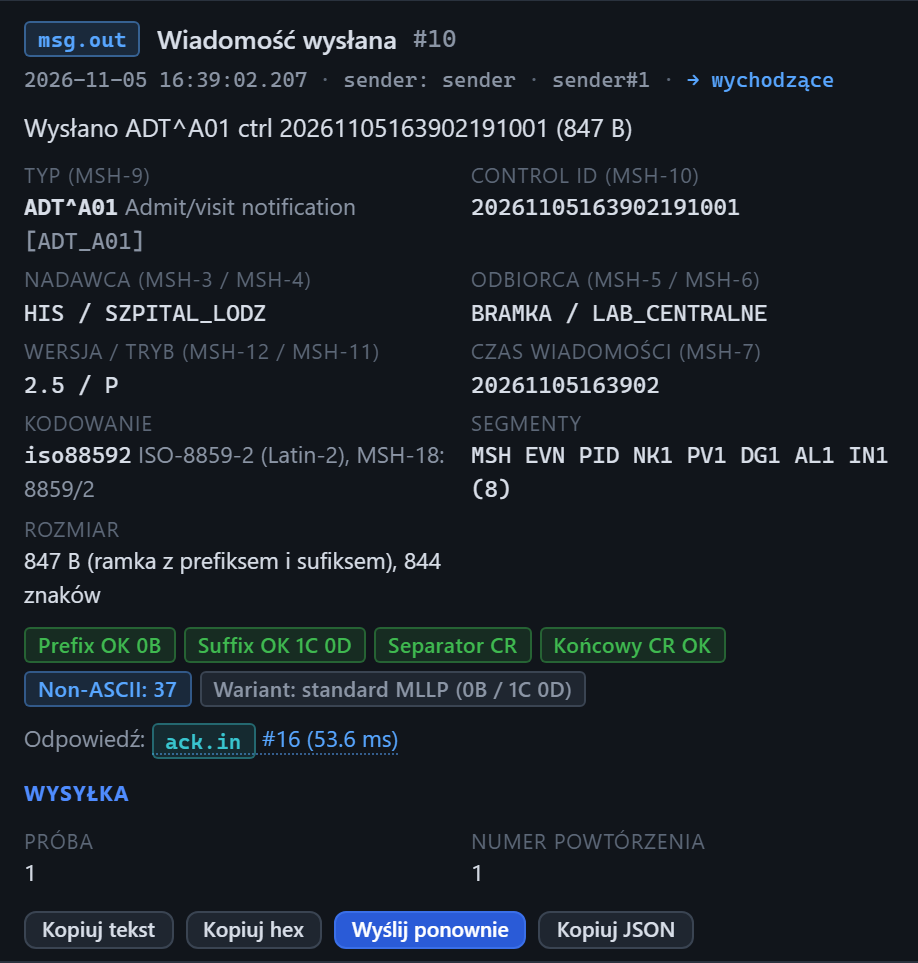

# Inspektor: wiadomość wysłana

[Spis treści](README.md) · Poprzednia: [ACK wysłany przez serwer](55-ack-wyslany.md) · Następna: [ACK otrzymany](57-ack-otrzymany.md) <!-- nav -->

> Sekcję **Wysyłka** pokazuje widok Pełny, patrz [Widok interfejsu](08-widok.md).

Zdarzenie `msg.out` **Wiadomość wysłana** to wiadomość, którą klient testera wysłał do bramki,
z panelu Klient albo ze scenariusza.

## Elementy

| Element | Znaczenie |
|---|---|
| Metadane | czas wysłania (gdy cała ramka wyszła), `sender: sender`, numer połączenia klienta (np. `sender#1`), `→ wychodzące` |
| Opis | np. „Wysłano ADT^A01 ctrl 2026…001 (847 B)”, przy serii z numerem wysyłki |
| Dane z nagłówka | jak przy [wiadomości odebranej](50-wiadomosc-odebrana.md): typ, control id, nadawca, odbiorca, wersja, czas, kodowanie, segmenty, rozmiar |
| Znaczki ramki | ramka, która faktycznie wyszła, porównana z ramką ustawioną w formularzu klienta. Przy celowo złej ramce (np. sufiks `0D0A`) znaczki prefiksu i sufiksu są więc zielone, a faktyczny rodzaj ramki pokazuje znaczek **Wariant** |
| **Odpowiedź:** | link do ACK od bramki (`ack.in`) z czasem odpowiedzi albo do zdarzenia brak ACK (`ack.timeout`). Napis „Brak powiązanego ACK przychodzącego” oznacza, że ACK jeszcze nie przyszedł albo nie da się go dopasować |

## Wysyłka

| Pole | Znaczenie |
|---|---|
| **Próba** | numer próby wysłania tej wiadomości |
| **Numer powtórzenia** | który to egzemplarz w serii, gdy pole Powtórzenia miało wartość większą niż 1 |

## Treść

Treść w zakładkach Czytelny, Drzewo i Hex to dokładnie to, co poszło do bramki: po podstawieniu
placeholderów, podmianie MSH-10 i normalizacji separatorów. Jeśli bramka twierdzi, że dostała coś
innego, porównaj z tym zdarzeniem.

Przyciski są takie jak przy [wiadomości odebranej](50-wiadomosc-odebrana.md#przyciski), bez Podglądu ACK.

---

[Spis treści](README.md) · Poprzednia: [ACK wysłany przez serwer](55-ack-wyslany.md) · Następna: [ACK otrzymany](57-ack-otrzymany.md) <!-- nav -->
