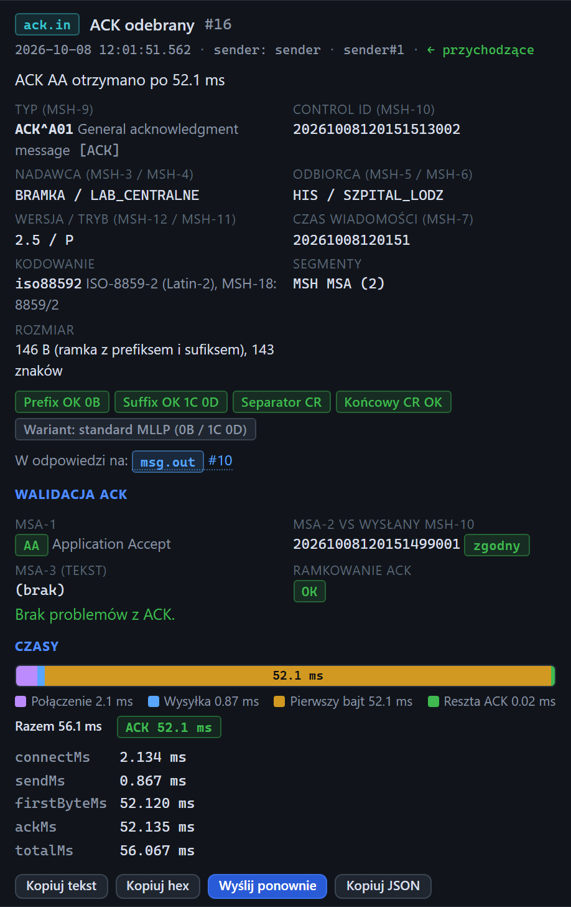

# Inspektor: ACK otrzymany

[Spis treści](README.md) · Poprzednia: [Wiadomość wysłana](56-wiadomosc-wyslana.md) · Następna: [Brak ACK](58-brak-ack.md) <!-- nav -->

Zdarzenie `ack.in` **ACK odebrany** to potwierdzenie, które bramka odesłała klientowi testera.
To najważniejsze zdarzenie przy teście bramki jako odbiorcy: mówi, czy bramka przyjęła wiadomość
i jak szybko odpowiedziała.

## Górna część

| Element | Znaczenie |
|---|---|
| Opis | np. „ACK AA otrzymano po 47.0 ms” |
| Dane z nagłówka | dane z MSH samego ACK: typ, control id ACK, nadawca (bramka), odbiorca, wersja, kodowanie |
| Znaczki ramki | ramka ACK w porównaniu z oczekiwaną ramką ACK z formularza klienta |
| **W odpowiedzi na:** | link do wysłanej wiadomości (`msg.out`) |

## Walidacja ACK

| Pole | Znaczenie |
|---|---|
| **MSA-1** | kod potwierdzenia z opisem. Zielony `AA` lub `CA`: przyjęte. Czerwony `AE`, `AR`, `CE`, `CR`: błąd albo odrzucenie |
| **MSA-2 vs wysłany MSH-10** | control id z ACK i znaczek **zgodny** albo **NIEZGODNY**. Niezgodny oznacza, że bramka potwierdziła inną wiadomość, np. poprzednią |
| **MSA-3 (tekst)** | opis od bramki; przy odrzuceniu zwykle powód |
| **Ramkowanie ACK** | **OK** albo **BŁĄD** |

Pod polami jest lista problemów albo zielony napis „Brak problemów z ACK.”. Możliwe problemy:

| Problem | Znaczenie |
|---|---|
| MSA-1 ma wartość AE, oczekiwano AA lub CA | bramka nie przyjęła wiadomości |
| MSA-2 (…) nie zgadza się z wysłanym MSH-10 (…) | ACK dotyczy innej wiadomości |
| ACK nie ma segmentu MSH / MSA | niepoprawny ACK |
| Typ wiadomości ACK to …, oczekiwano ACK | w MSH-9 ACK jest inny typ |
| Prefiks ACK niezgodny / Sufiks ACK niezgodny | ramka ACK inna niż oczekiwana |
| Nie udało się odczytać ACK | odpowiedź nie jest poprawną wiadomością HL7 |

## Czasy

Pasek i legenda działają tak jak w [wyniku wysyłki](23-wynik-wysylki.md#pasek-czasów). Pod paskiem
tabela z dokładnymi czasami w milisekundach z trzema miejscami po przecinku:

| Czas | Od | Do |
|---|---|---|
| `connectMs` | start wysyłki | nawiązane połączenie TCP |
| `sendMs` | nawiązane połączenie | wypchnięta cała ramka |
| `firstByteMs` | wypchnięta ramka | pierwszy bajt odpowiedzi |
| `ackMs` | wypchnięta ramka | kompletny ACK; **czas odpowiedzi bramki** |
| `totalMs` | start wysyłki | koniec wymiany |

Przy serii na jednym połączeniu (keepAlive) połączenie już istnieje od drugiej wiadomości, więc `connectMs` kolejnych wiadomości jest bliski zera.

## Przyciski

**Kopiuj tekst**, **Kopiuj hex**, **Wyślij ponownie** (treść ACK do edytora klienta) i **Kopiuj JSON**.

---

[Spis treści](README.md) · Poprzednia: [Wiadomość wysłana](56-wiadomosc-wyslana.md) · Następna: [Brak ACK](58-brak-ack.md) <!-- nav -->
