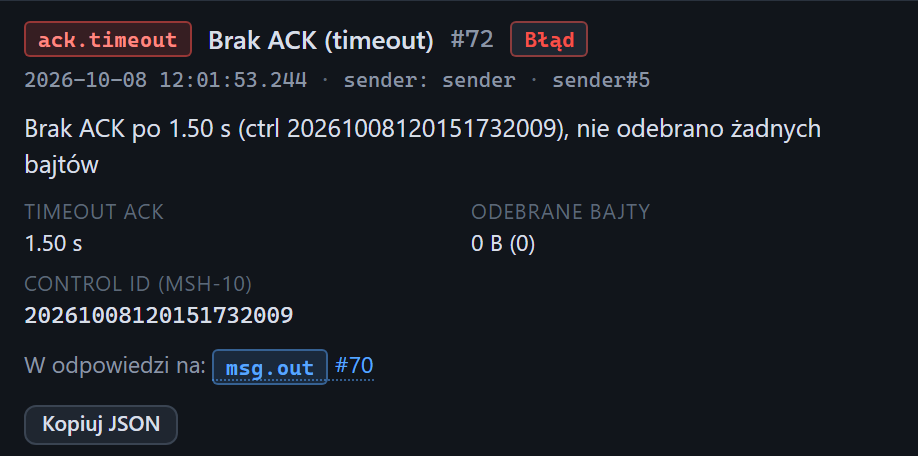

# Inspektor: brak ACK

[Spis treści](README.md) · Poprzednia: [ACK otrzymany](57-ack-otrzymany.md) · Następna: [Niekompletna ramka](59-niekompletna-ramka.md) <!-- nav -->

Zdarzenie `ack.timeout` **Brak ACK (timeout)** powstaje, gdy klient testera wysłał wiadomość, a bramka
nie odesłała kompletnego ACK w czasie z pola **Timeout ACK**. Ma poziom **Błąd** i czerwony znaczek
`timeout` na osi czasu.

## Elementy

| Element | Znaczenie |
|---|---|
| Opis | np. „Brak ACK po 1.50 s (ctrl 2026…009), nie odebrano żadnych bajtów” albo „odebrano 52 B bez sufiksu” |
| **Timeout ACK** | ile klient czekał |
| **Odebrane bajty** | ile bajtów odpowiedzi przyszło przed upływem czasu |
| **Odebrany tekst** | te bajty jako tekst, gdy jakieś przyszły |
| **Control ID (MSH-10)** | identyfikator wiadomości, na którą zabrakło odpowiedzi |
| **W odpowiedzi na:** | link do wysłanej wiadomości (`msg.out`) |
| **Kopiuj JSON** | całe zdarzenie |

Gdy przyszła część odpowiedzi, inspektor pokazuje też [znaczki ramki](51-znaczki-ramki.md) tych bajtów,
ostrzeżenia i zakładki z ich treścią, w tym [Hex](54-zakladka-hex.md).

## Jak czytać

| Sytuacja | Najczęstsza przyczyna | Co zrobić |
|---|---|---|
| nie odebrano żadnych bajtów | bramka nie rozpoznała końca ramki (inny sufiks niż oczekuje), nie przetworzyła wiadomości albo odpowiada innym połączeniem | sprawdź sufiks wysyłki i ustawienia ramki w bramce; sprawdź log bramki |
| odebrano bajty bez sufiksu | bramka odpowiada, ale inną ramką niż oczekiwana | w zakładce Hex odczytaj faktyczny sufiks i wpisz go w pole **Suffix ACK** formularza klienta |
| brak ACK przy celowo złej ramce | poprawne zachowanie bramki | to oczekiwany wynik testu, np. scenariusza `09_zly_sufiks` |
| brak ACK tylko przy dużych wiadomościach | bramka potrzebuje więcej czasu | zwiększ **Timeout ACK** i porównaj czasy |

---

[Spis treści](README.md) · Poprzednia: [ACK otrzymany](57-ack-otrzymany.md) · Następna: [Niekompletna ramka](59-niekompletna-ramka.md) <!-- nav -->
