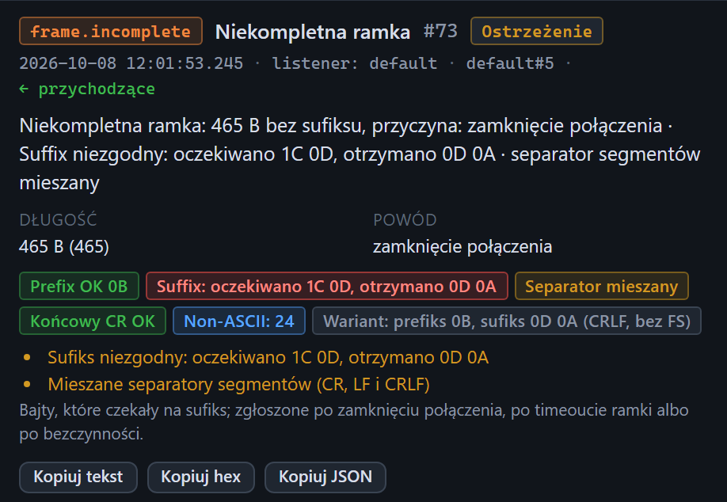

# Inspektor: niekompletna ramka

[Spis treści](README.md) · Poprzednia: [Brak ACK](58-brak-ack.md) · Następna: [Zdarzenia połączeń i inne zdarzenia techniczne](60-zdarzenie-polaczenia.md) <!-- nav -->

Zdarzenie `frame.incomplete` **Niekompletna ramka** oznacza bajty, które czekały na sufiks, ale
sufiks nie przyszedł. Ma poziom **Ostrzeżenie**. To główny sposób wykrywania złego sufiksu bramki.

## Skąd się bierze

| Punkt | Sytuacja |
|---|---|
| listener (np. `listener: default`) | bramka wysłała wiadomość do testera, ale zakończyła ją innym sufiksem niż ustawiony na listenerze |
| `sender` | bramka zaczęła odpowiadać klientowi, nie dokończyła ACK oczekiwanym sufiksem i zamknęła połączenie |

## Elementy

| Element | Znaczenie |
|---|---|
| Opis | np. „Niekompletna ramka: 465 B bez sufiksu, przyczyna: zamknięcie połączenia · Suffix niezgodny: oczekiwano 1C 0D, otrzymano 0D 0A” |
| **Długość** | ile bajtów czekało |
| **Powód** | kiedy program przestał czekać, tabela niżej |
| [Znaczki ramki](51-znaczki-ramki.md) | najważniejszy jest czerwony znaczek sufiksu z faktycznymi ostatnimi bajtami i znaczek **Wariant** z rozpoznanym rodzajem ramki |
| Lista ostrzeżeń | szczegóły analizy, np. „Sufiks niezgodny”, „Mieszane separatory segmentów” |
| Zakładki | Czytelny, Drzewo i Hex z odebranymi bajtami |

## Powody

| Powód | Znaczenie |
|---|---|
| **timeout** | przez czas z pola **Timeout ramki** listenera (domyślnie 3 s) nie przyszedł żaden nowy bajt. Połączenie zostaje otwarte, a bramka może wysyłać dalej |
| **bezczynność** | minął **Timeout bezczynności** listenera; połączenie zostało zamknięte |
| **zamknięcie połączenia** | druga strona zamknęła połączenie, zanim przyszedł sufiks |

## Co zrobić

1. Odczytaj faktyczny sufiks ze znaczka albo z zakładki [Hex](54-zakladka-hex.md).
2. Jeśli bramka powinna wysyłać standardowe MLLP (`1C 0D`), zgłoś błąd konfiguracji bramki.
3. Jeśli bramka celowo używa innej ramki, ustaw ten sufiks w [formularzu serwera](13-formularz-serwera-ack.md)
   albo w polu **Suffix ACK** klienta.

Bramka zwykle czeka na ACK i nie dostaje go, bo listener nie uznał wiadomości za kompletną. W logu
bramki widać to jako timeout po jej stronie.

---

[Spis treści](README.md) · Poprzednia: [Brak ACK](58-brak-ack.md) · Następna: [Zdarzenia połączeń i inne zdarzenia techniczne](60-zdarzenie-polaczenia.md) <!-- nav -->
