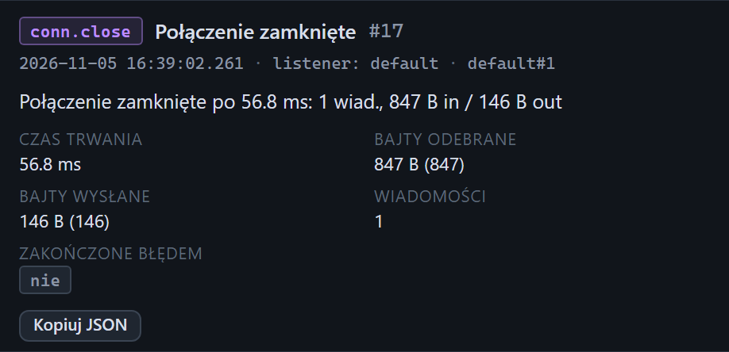

# Inspektor: zdarzenia połączeń i inne zdarzenia techniczne

[Spis treści](README.md) · Poprzednia: [Niekompletna ramka](59-niekompletna-ramka.md) · Następna: [Krok scenariusza](61-krok-scenariusza.md) <!-- nav -->

> Widoki Prosty i Standardowy nie pokazują na osi czasu zdarzeń `conn.open`, `conn.close` i `sender.connect`. Błędy połączeń (`conn.error`, `sender.error`) są w każdym widoku, patrz [Widok interfejsu](08-widok.md).

Zdarzenia bez treści HL7 mają w inspektorze prostszy widok: tytuł, metadane, opis i siatkę pól.
Nie mają zakładek Czytelny, Drzewo i Hex. Na zrzucie zamknięcie połączenia (`conn.close`).

## Pola według typu zdarzenia

| Typ | Pola |
|---|---|
| `conn.open` Połączenie otwarte | **Adres zdalny**, **Port zdalny**, **Port lokalny**: kto i skąd się połączył |
| `conn.close` Połączenie zamknięte | **Czas trwania**, **Bajty odebrane**, **Bajty wysłane**, **Wiadomości**, **Zakończone błędem** (tak albo nie) |
| `conn.error` Błąd połączenia | **Kod** (np. `ECONNRESET`, `E_MAX_SIZE`), **Komunikat** |
| `sender.connect` Połączenie nadawcy | **Host**, **Port**, **Udane**, **Czas łączenia**, **Błąd**; czas także w znaczku **Czas odpowiedzi** |
| `sender.error` Błąd nadawcy | **Kod**, **Komunikat**, **Faza** (łączenie, wysyłka, oczekiwanie na ACK) |
| `listener.started` Nasłuch uruchomiony | **Host**, **Port**, **Prefiks (hex)**, **Sufiks (hex)**, **Kodowanie**, **ACK** (tryb i opóźnienie) |
| `listener.stopped` Nasłuch zatrzymany | **Powód**: zatrzymanie (Stop, zmiana konfiguracji albo wyłączenie programu) |
| `listener.error` Błąd nasłuchu | **Kod** (np. `EADDRINUSE`), **Komunikat** |
| `ack.skipped` ACK pominięty | **W odpowiedzi na (MSH-10)**, **Powód**: tryb ACK none, nie udało się zbudować ACK albo połączenie zamknięte przed wysłaniem ACK |
| `bytes.in`, `bytes.out` Bajty odebrane / wysłane | **Długość**, **Razem na połączeniu**; zakładka Hex z pierwszymi 32 bajtami |
| `system.started` Start systemu | **Serwer WWW** (adres interfejsu), **Wersja** |

Wartości logiczne są pokazane jako znaczki **tak** i **nie**, rozmiary w bajtach z liczbą w nawiasie,
czasy w milisekundach albo sekundach.

## Jak to wykorzystać

- **Ile wiadomości bramka przesłała jednym połączeniem i jak długo je trzymała:** `conn.close`.
- **Czy bramka łączy się z właściwego adresu:** **Adres zdalny** w `conn.open`.
- **Dlaczego połączenie się urwało:** `conn.error` z kodem; `ECONNRESET` oznacza zerwanie przez drugą stronę.

Przyciski: **Kopiuj JSON** zawsze, a dla zdarzeń bajtów także **Kopiuj hex**.

---

[Spis treści](README.md) · Poprzednia: [Niekompletna ramka](59-niekompletna-ramka.md) · Następna: [Krok scenariusza](61-krok-scenariusza.md) <!-- nav -->
