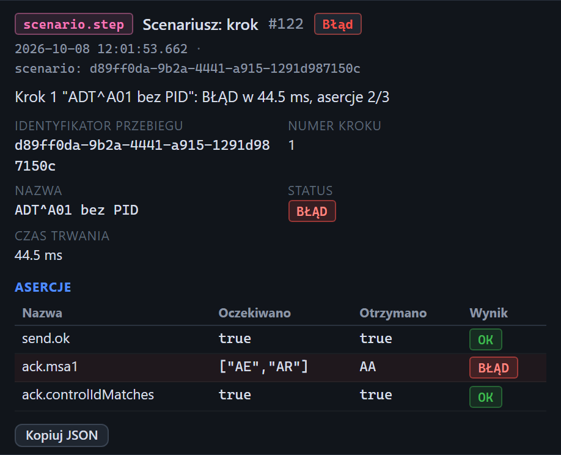

# Inspektor: krok scenariusza

[Spis treści](README.md) · Poprzednia: [Zdarzenia połączeń i inne zdarzenia techniczne](60-zdarzenie-polaczenia.md) · Następna: [Okno Podgląd ACK](62-podglad-ack.md) <!-- nav -->

Każdy przebieg scenariusza zapisuje na osi czasu trzy rodzaje zdarzeń. W kolumnie Punkt mają
identyfikator przebiegu (długi ciąg znaków), a w inspektorze `scenario: <identyfikator>`.

| Typ | Kiedy | Pola w inspektorze |
|---|---|---|
| `scenario.start` Scenariusz: start | początek przebiegu | **Identyfikator przebiegu**, **Nazwa**, **Liczba kroków** |
| `scenario.step` Scenariusz: krok | koniec każdego kroku | **Identyfikator przebiegu**, **Numer kroku**, **Nazwa**, **Status**, **Czas trwania**, tabela **Asercje** |
| `scenario.end` Scenariusz: koniec | koniec przebiegu | **Identyfikator przebiegu**, **Status**, **Czas trwania**, **Kroki udane**, **Kroki nieudane** |

Nieudany krok i nieudany przebieg mają poziom **Błąd**: czerwony opis na osi czasu i znaczek w inspektorze.

## Tabela asercji

To ta sama tabela warunków co w [wyniku scenariusza](34-wynik-scenariusza.md#tabela-warunków):
**Nazwa**, **Oczekiwano**, **Otrzymano**, **Wynik**. Na zrzucie warunek `ack.msa1` oczekiwał
`["AE","AR"]`, a bramka odpowiedziała `AA`.

## Do czego służy

- Kroki scenariusza na osi czasu stoją między wiadomościami i ACK tego kroku, więc widać, który
  ruch sieciowy należy do którego kroku.
- Filtr punktu ustawiony na identyfikator przebiegu (przycisk **Zdarzenia tego uruchomienia**)
  pokazuje sam przebieg krok po kroku.
- **Kopiuj JSON** kopiuje zdarzenie kroku, np. do zgłoszenia.

---

[Spis treści](README.md) · Poprzednia: [Zdarzenia połączeń i inne zdarzenia techniczne](60-zdarzenie-polaczenia.md) · Następna: [Okno Podgląd ACK](62-podglad-ack.md) <!-- nav -->
