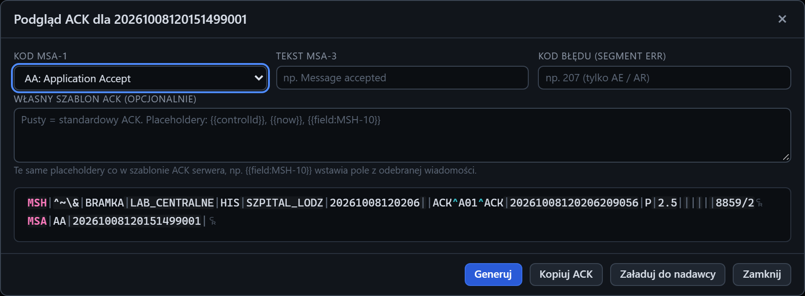

# Okno Podgląd ACK

[Spis treści](README.md) · Poprzednia: [Krok scenariusza](61-krok-scenariusza.md) <!-- nav -->

Okno otwiera przycisk **Podgląd ACK** w inspektorze odebranej wiadomości (`msg.in`). Pokazuje ACK,
jaki listener testera zbudowałby dla tej wiadomości przy wybranych ustawieniach. Niczego nie wysyła.
W tytule jest control id wiadomości.

## Pola

| Pole | Znaczenie |
|---|---|
| **Kod MSA-1** | `AA` Application Accept, `AE` Application Error, `AR` Application Reject, `CA` Commit Accept, `CE` Commit Error, `CR` Commit Reject. Zmiana od razu generuje ACK od nowa |
| **Tekst MSA-3** | tekst w polu MSA-3 |
| **Kod błędu (segment ERR)** | tylko dla AE i AR: dodaje segment ERR z tym kodem, w formacie zależnym od wersji wiadomości |
| **Własny szablon ACK (opcjonalnie)** | szablon jak w trybie `custom` listenera, z placeholderami, np. `{{field:MSH-10}}`. Puste pole: standardowy ACK |
| Wynik | wygenerowany ACK z kolorowaniem |

Standardowy ACK ma nadawcę i odbiorcę zamienionych miejscami względem wiadomości, MSH-9 `ACK` albo
`ACK^<zdarzenie>^ACK` zależnie od wersji, wersję, tryb i MSH-18 skopiowane z wiadomości oraz w MSA-2
control id wiadomości.

## Przyciski

| Przycisk | Działanie |
|---|---|
| **Generuj** | generuje ACK po zmianie tekstu, kodu błędu albo szablonu |
| **Kopiuj ACK** | kopiuje wygenerowany ACK do schowka |
| **Załaduj do nadawcy** | wkłada ACK do edytora w sekcji Klient i zamyka okno |
| **Zamknij**, `×`, `Esc` | zamyka okno |

## Do czego służy

- Sprawdzenie, jaki dokładnie ACK dostaje bramka od testera.
- Przygotowanie szablonu dla trybu `custom` przed zapisaniem go w [formularzu serwera](13-formularz-serwera-ack.md).
- Wzór ACK dla zespołu bramki albo systemu, który ma odpowiadać na takie wiadomości.

---

[Spis treści](README.md) · Poprzednia: [Krok scenariusza](61-krok-scenariusza.md) <!-- nav -->
